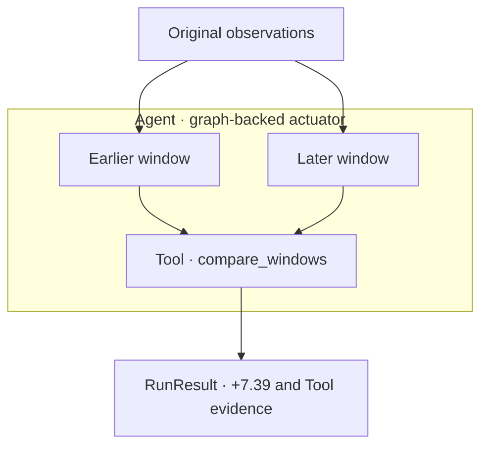
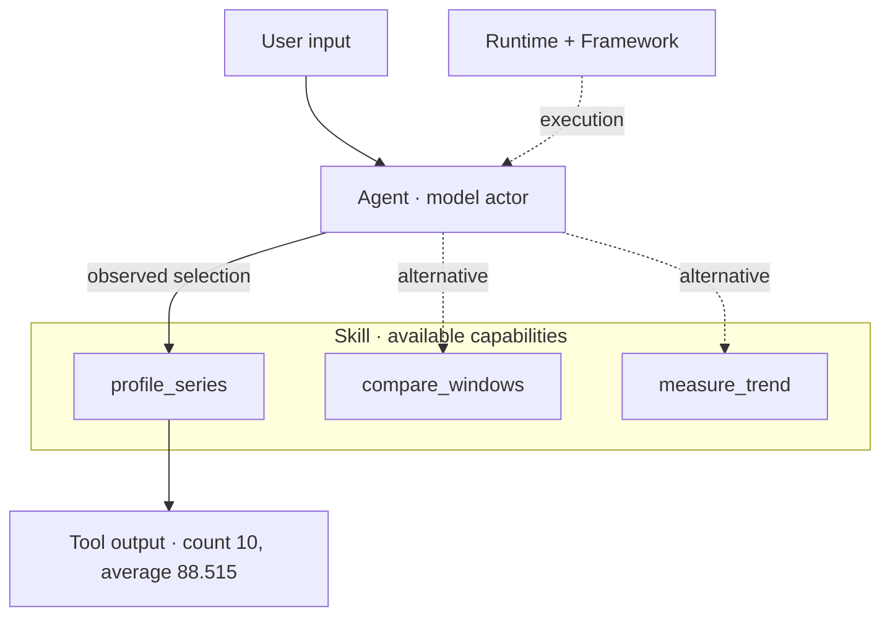
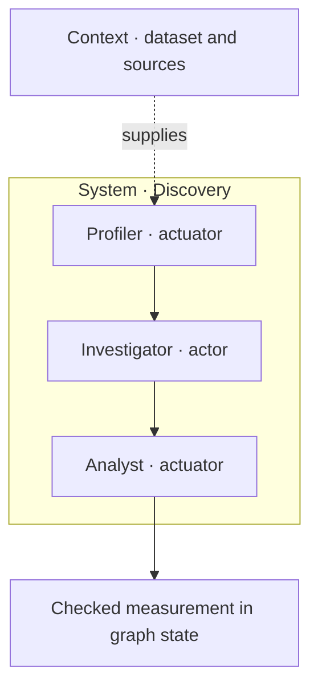
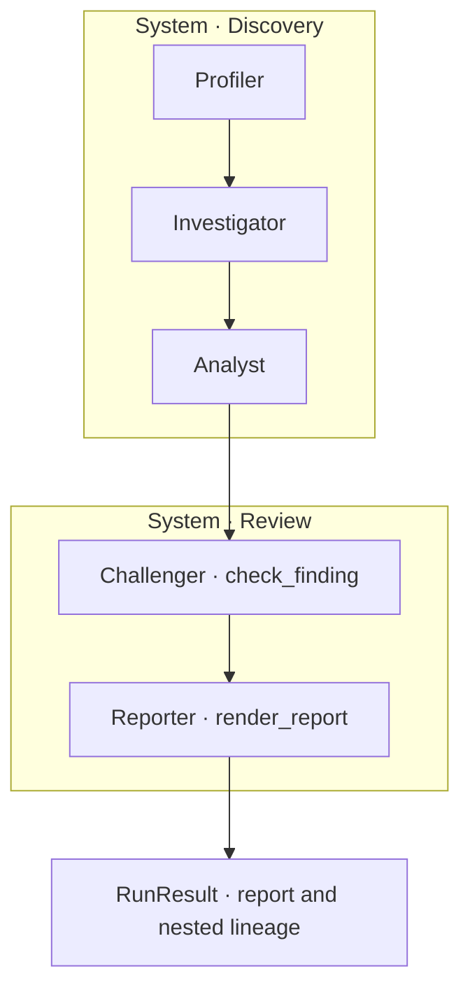
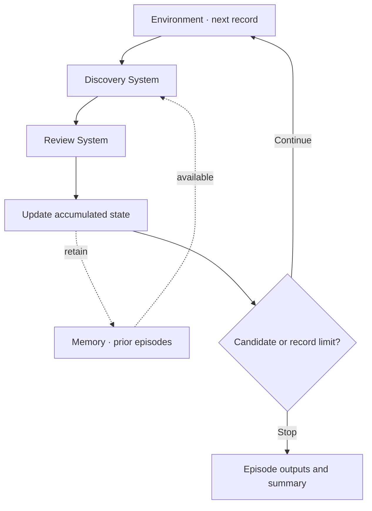
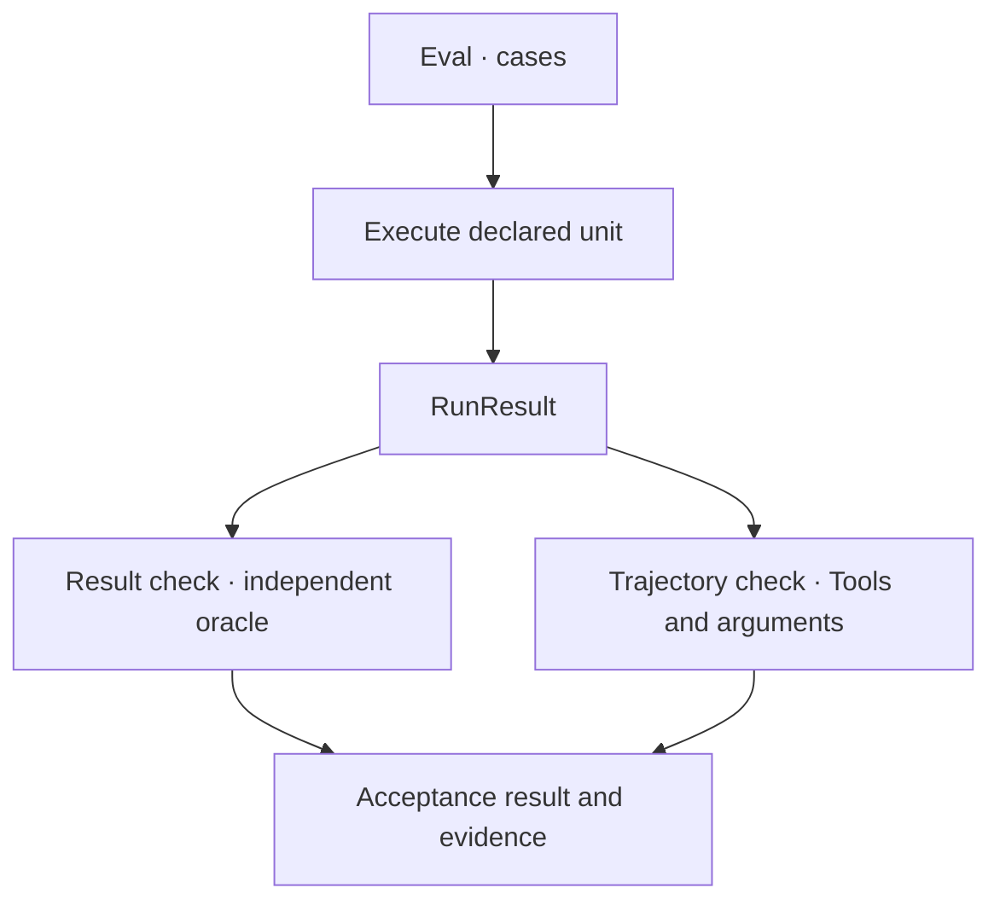
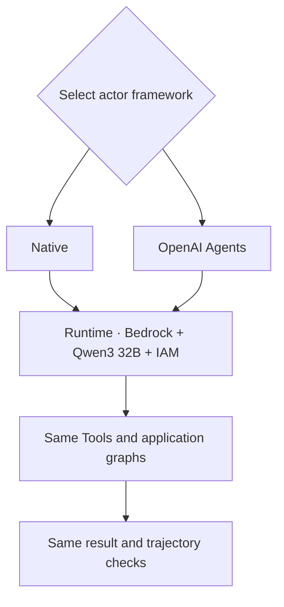

<p align="center">
  
</p>

# Agentic Systems

**Agentic Systems is a computational grammar for building applications from executable capabilities, explicit graphs and model actors, with shared execution evidence.**

Use the same Python objects to compose deterministic operations and model-selected actions, coordinate them, run episodes and evaluate both outputs and trajectories.

| Object | Responsibility |
|---|---|
| **Tool** | Execute an operation with validated arguments |
| **Skill** | Group reusable Tools and capability instructions |
| **Agent** | Own a capability: a model actor or a graph-backed actuator |
| **Graph** | Declare state flow, execution edges and branching |
| **System** | Coordinate capabilities, including nested Systems |
| **Runtime / Framework** | Select the provider/model and the actor execution framework independently |
| **Context / Memory** | Supply immutable references and bounded episode history |
| **Environment** | Supply records, accumulate episode state and decide when to stop |
| **Eval** | Execute acceptance cases and check results and trajectories |
| **RunResult** | Retain outputs, usage, failures and nested execution evidence |

Actors choose actions through a model. Actuators follow the graph you declare. Both use `Agent`, both operate through Tools, and both return inspectable results. LangGraph orchestrates graphs; Native or OpenAI Agents executes actors; the runtime supplies Python or model-provider execution.

The sections below introduce these objects progressively through one real-data example. **User input** states the request; **Agentic Systems output** shows recorded values or an explicitly labeled summary. These panels are a teaching presentation, not verbatim conversation transcripts.

**Version:** documentation proposal for 2.1.9, supported by executions of SDK **2.1.8**. Release-candidate validation is still pending. Explicit Agent contracts and policies remain in the 2.1.10 scope.

## Start with the executable example

Open [ADA_Time_Series_Discovery_219_Core.ipynb](examples/time_series_discovery_219/ADA_Time_Series_Discovery_219_Core.ipynb). Its filename describes the development target; its dependency pin is `agentic-systems==2.1.8`.

The application notebook contains visible declarations and the complete runnable example. To inspect actual outputs without making model calls, open the **[recorded outputs notebook](examples/time_series_discovery_219/Recorded_Outputs.ipynb)**. Its cells were executed against the committed [Native evidence](examples/time_series_discovery_219/outputs/native.json) and [OpenAI Agents evidence](examples/time_series_discovery_219/outputs/openai_agents.json); GitHub renders the saved tables and outputs.

This viewer does not pretend to be the original application notebook. The uploaded Native PDF contains a **different failed rerun** (page 25); the earlier Native PASS comes from its JSON bundle. The OpenAI Agents PDF shows PASS (page 21). The [failed-rerun record](examples/time_series_discovery_219/outputs/native_failed_rerun.json) preserves that distinction.

Install into the notebook kernel:

```python
%pip install "agentic-systems[bedrock,openai-agents]==2.1.8" "matplotlib>=3.8" "nbformat>=5.10" "nbclient>=0.10" "ipykernel>=6"
```

Restart the kernel after upgrading an already imported SDK, then configure and Run All.

```python
RUN_BEDROCK = True
LIVE_FRAMEWORKS = ("openai-agents",)
# Alternatives: ("native",) or ("native", "openai-agents")

BEDROCK_MODEL_ID = "qwen.qwen3-32b-v1:0"
AWS_REGION = "us-east-1"
```

For local execution only, set `RUN_BEDROCK=False`. Python runs explicitly selected operations; it does not interpret the natural-language questions.

The notebook reuses an existing Boto3 `session` or unwraps `sagemaker_session.boto_session`. Otherwise it creates a Boto3 session using the environment credential chain. No OpenAI API key is needed for the Bedrock/OpenAI Agents profile.

The current continuation configuration retains the existing campaign ledger and explicitly raises its cumulative cap from 60 to 100 HTTP attempts. Keep the same working directory. It expects the existing ledger; set `ALLOW_NEW_CAMPAIGN=True` only for a first-ever campaign. Budget preflight, send counting and failures are recorded. Changing the framework does not reset the counter.

## The teaching example: time-series discovery

| Property | Value |
|---|---|
| Publisher / dataset | FAO / FAOSTAT Production Indices, QI |
| Series | Mexico / Agriculture / Gross Production Index Number |
| Base | 2014–2016 = 100 |
| Coverage | Annual, 1961–2024; 64 observations |
| Source flags | `E`: estimated values |
| Snapshot | [data/series.json](examples/time_series_discovery_219/data/series.json), also embedded in the notebook |
| Transformation | Exact identifier filtering, type conversion and chronological sorting; no imputation or smoothing |
| Snapshot SHA256 | `59109a8fc4f18b0bf73ab9a19df2357800a303debaa23ceb2f505363f271fab2` |

Source provenance, retrieval time and archive hash are recorded in the JSON. The notebook validates the frozen snapshot before analysis; ADA does not need to download FAOSTAT data.

The initial comparison uses 2005–2009 versus 2010–2014. The episodic investigation uses successive non-overlapping ten-year blocks, comparing each block's two five-year halves.

## 1. Tool + Graph + Agent actuator

A **Tool** is the executable unit. A **Graph** declares how it runs and writes state. An **Agent(graph=...)** owns that deterministic capability.

**User input**

> Compare the observations and show what supports the finding.

**Agentic Systems output**

```text
Earlier mean: 84.820
Later mean: 92.210
Difference: +7.390 index points
```



**context:** Ten observations from 2005–2014, split into equal chronological windows. This is a descriptive comparison; it does not establish a structural break or a cause.

**internals:** A Tool computes the means. A graph-backed actuator executes that operation.

**grammar:** `tool` → `Graph` → `Agent(graph=...)` → `RunResult`.

**route:** Observations → comparison actuator → `compare_windows` → measurement.

This standalone excerpt shows the first declaration:

```python
from statistics import mean
import math
from pydantic import BaseModel
import agentic_systems as toolkit

class ComparisonState(BaseModel):
    values: list[float]
    measurement: dict = {}

@toolkit.tool
def compare_windows(values: list[float]) -> dict:
    """Compare the means of equal chronological windows."""
    if len(values) < 4 or len(values) % 2:
        raise ValueError("Two equal windows are required")
    if not all(math.isfinite(value) for value in values):
        raise ValueError("Finite observations are required")
    midpoint = len(values) // 2
    earlier = mean(values[:midpoint])
    later = mean(values[midpoint:])
    return {"measurement": {
        "earlier_mean": earlier,
        "later_mean": later,
        "difference": later - earlier,
    }}

graph = toolkit.Graph(ComparisonState)
graph.add_node("compare", compare_windows)
graph.add_edge(toolkit.START, "compare")
graph.add_edge("compare", toolkit.END)
actuator = toolkit.Agent("comparison_actuator", graph=graph)

result = actuator.run({"values": [
    80.09, 83.88, 85.97, 88.18, 85.98,
    88.71, 87.69, 92.28, 94.53, 97.84,
]})
assert result.ok
print(result.data["measurement"])
```

The notebook uses a richer measurement schema shared by its later blocks. Evidence: `01_comparison.evidence.json`.

## 2. Skill + Runtime + Framework + Agent actor

A **Skill** groups capabilities. An **Agent(runtime=...)** delegates action selection to a model through a **Framework**. The **Runtime** selects the provider and model.

**User input**

> Describe the observations instead of comparing the periods.

**Agentic Systems output**

```text
{'profile': {'count': 10, 'average': 88.515, 'minimum': 80.09, 'maximum': 97.84}}
```



**context:** A Skill exposes description, comparison and endpoint-slope Tools. Instructions ask the actor to choose one appropriate Tool and preserve all observations.

**internals:** The model chooses the operation; the selected Tool performs arithmetic. External checks inspect the actual Tool name and arguments.

**grammar:** `skill` + `runtime` + `framework` → `Agent(runtime=...)`.

**route:** Question → actor → Tool selection → execution → recorded result.

Both Bedrock/Native and Bedrock/OpenAI Agents selected the correct description Tool. Evidence: `bedrock_native_description.evidence.json` and `bedrock_openai_agents_description.evidence.json`.

## 3. System + Context + validated state

A **System** coordinates capabilities through a graph. **Context** carries reference information; graph state carries the changing business outputs.

**User input**

> Compare the periods and check the measurement before forwarding a finding.

**Agentic Systems output**

```text
Selected: compare_windows
Measurement checked: True
```



**context:** Dataset identity, source reference and declared business criteria live in `Context`. Business channels such as measurements and validation flags live in graph state.

**internals:** Three Agents contribute distinct responsibilities:

| Agent | Role | Operation |
|---|---|---|
| Profiler | Actuator | Runs `profile_series` through a graph |
| Investigator | Actor | Selects an analysis Tool |
| Analyst | Actuator | Runs `validate_measurement` through a graph |

**grammar:** Multiple `Agent` declarations → coordination `Graph` → `System`, with `Context` and bounded `Memory`.

**route:** Discovery → Profiler → Investigator → Analyst → checked measurement.

Evidence: each profile's Environment descendants and `*_eval.evidence.json`.

## 4. System composition + nested evidence

A System can contain other Systems. Their child executions remain connected in the parent **RunResult**, so composition preserves inspectability.

**User input**

> Review the finding and produce a report backed by execution evidence.

**Agentic Systems output**

```text
2005–2014: difference=+7.390 index points; review=no_candidate; threshold=10.0.
Descriptive screening only; no statistical significance or causal claim.
```



**context:** At least ten observations and an absolute difference of at least ten index points identify a review candidate. This business screening rule is implemented in a Tool; it is not an explicit Agent `policy` declaration.

**internals:** Challenger selects `check_finding`. Reporter is a graph-backed actuator that runs `render_report`. Together with the three Discovery roles, the application has five logical Agents and two coordinated Systems.

**grammar:** System composition → nested Agents → `evidence()` and `lineage()`.

**route:** Discovery System → Review System → reviewed report.

Evidence: `check_finding` and `render_report` events in each live Environment bundle. Review verifies observations and arithmetic; agreement between models is not its acceptance criterion.

## 5. Environment + Memory + episode state

An **Environment** executes a graph over records. Its accumulated state, update function and stop function govern episodes. **Memory** makes bounded prior observations available.

**User input**

> Process successive periods, retain previous observations and stop when a candidate requires review.

**Agentic Systems output**

```text
processed: 4
candidate_found: true
reason: stop
truncated: false
```



**context:** Chronological ten-year records, bounded episode history, accumulated processed count and candidate flag.

**internals:** Environment executes the Discovery/Review graph per record. `update` accumulates state; `stop` checks the candidate flag. Prior episodes are available through context.

**grammar:** `Environment` + `records` + `state` + `update` + `stop` + `max_steps` + `Memory`.

**route:** Record → Discovery/Review → state update → stop decision → next record if needed.

Both frameworks produced the same observed progression:

| Episode | Period | Difference, index points | Prior episodes available | Decision |
|---|---|---:|---:|---|
| 1 | 1961–1970 | +5.928 | 0 | Continue |
| 2 | 1971–1980 | +7.850 | 1 | Continue |
| 3 | 1981–1990 | +3.142 | 2 | Continue |
| 4 | 1991–2000 | +10.034 | 3 | Stop: candidate |

Evidence: `*_environment.evidence.json`; summary reports `processed=4`, `candidate_found=true`, `reason="stop"` and `truncated=false`.

The final difference exceeds the threshold by only 0.034 points. The result is sensitive to the declared threshold and windows. Availability of history does not demonstrate that memory improved analytical quality.

## 6. Eval + result and trajectory checks

An **Eval** executes an Agent, System or Environment against cases. Checks can inspect both business data and the actual operations that produced it.

**User input**

> Verify the finding and confirm that the required operations used the original observations.

**Agentic Systems output**

```text
06_eval_agent status= completed invariants= True
06_eval_system status= completed invariants= True
06_eval_environment status= completed invariants= True
06_negative_wrong_answer status= failed invariants= True
06_invalid_windows status= completed invariants= True
```



**context:** A numerical oracle using `math.fsum` checks the result independently of the comparison Tool. Trajectory checks inspect operation order, successful status and exact original values.

**internals:** Eval executes the declared unit and applies checks to its `RunResult`. Separate negative evaluations retain evidence of deliberately rejected behavior.

**grammar:** `Eval` → `unit` + `cases` + `checks` → evaluation result.

**route:** Case → actual execution → result checks + trajectory checks → acceptance evidence.

| Evaluation | Observed outcome |
|---|---|
| Local Agent acceptance | PASS |
| Local Discovery System acceptance | PASS |
| Local Environment acceptance | PASS |
| Deliberately incorrect expected difference | Rejected as intended |
| Invalid odd-sized comparison windows | Rejected as intended |
| Live Discovery result and trajectory, Native | PASS |
| Live Discovery result and trajectory, OpenAI Agents | PASS |

Evidence: `06_*` and `*_eval.evidence.json`. A failed negative-control execution can be the correct test outcome. Structural invariants are checked separately from analytical correctness.

Eval is fail-fast. Memory isolation is process-local and starts from existing toolkit history; it does not isolate SDK sessions or external effects. Use separate evaluations when each negative case needs a report.

## 7. Framework portability + shared Runtime

**Framework** and **Runtime** are independent choices. Reconstruct actors with another framework while preserving the provider, Tools and surrounding graphs; then evaluate that profile.

**User input**

> Run the actors through OpenAI Agents while retaining Bedrock, IAM and Qwen3 32B.

**Agentic Systems output**

```text
bedrock_openai_agents_description status= completed invariants= True
bedrock_openai_agents_environment status= completed invariants= True
bedrock_openai_agents_eval status= completed invariants= True
```



**context:** Same dataset, Tools, Skills, graph structure, provider and model; fresh application Memory per profile. Sessions stay outside serialized configuration.

**internals:** Reconstruct the actors using the selected framework. Native uses `max_turns=1`; OpenAI Agents uses `max_turns=2` to allow Tool selection and final response. Both use `max_tool_calls=1` per actor.

**grammar:** Independent framework and runtime selection, preserving graph composition and external Evals.

**route:** Selected framework → Bedrock actor → Tool → graph continuation → evidence.

**OpenAI Agents is the framework; Bedrock remains the provider.** LangGraph orchestrates the surrounding graphs. Actors and actuators are architectural roles implemented through `Agent`.

| Layer | Role in this example |
|---|---|
| Tool | Deterministic operation and argument validation |
| Skill | Reusable capability group and instructions |
| Runtime | Provider, model, borrowed session and operational limits |
| Framework | Native or OpenAI Agents actor execution |
| Graph | Explicit execution edges and state flow |
| Agent | Model actor or graph-backed actuator |
| System | Application coordination |
| Context | Immutable reference data and sources |
| Memory | Bounded local episode history |
| Environment | Records, episode updates and stopping |
| Eval | Result and trajectory acceptance |
| RunResult | Outputs, failures, usage and execution evidence |

The framework comparison is observed compatibility for this scenario, not universal feature parity.

## Observed framework comparison

Numbers cover description + Environment + live Discovery Eval. The two profiles were executed separately.

| Measurement | Bedrock / Native | Bedrock / OpenAI Agents |
|---|---:|---:|
| Description selection | PASS | PASS |
| Environment and stopping check | PASS | PASS |
| Discovery result/trajectory Eval | PASS | PASS |
| Environment episodes | 4 | 4 |
| Environment Tool calls | 20 | 20 |
| Live inference requests | 20 | 20 |
| Input tokens | 53,039 | 51,920 |
| Output tokens | 1,741 | 1,636 |
| Total tokens | 54,780 | 53,556 |
| Structural invariants across 13 saved results | PASS | PASS |

OpenAI Agents used about 2.2% fewer tokens in these executions. A single run per profile is insufficient to establish an efficiency ranking or a reliability rate.

History increased Environment input tokens substantially:

| Episode | Native | OpenAI Agents |
|---|---:|---:|
| First | 4,152 | 4,049 |
| Fourth | 17,068 | 16,508 |

These counts aggregate both actors per episode. Compact history is a potential optimization; it requires its own evaluation.

## Inspect and export the execution

With a result from the notebook:

```python
evidence = result.evidence()
lineage = result.lineage().to_dict()
trace = result.trace()
validation = result.check_invariants()

print(result.human_results())
for execution in result.walk():
    print(execution.execution_id, execution.status)
```

`compile()` prepares a definition without business execution or inference. `run()` and `arun()` execute it; direct execution compiles internally. Async execution alone does not introduce parallel branches.

| Saved artifact | Purpose |
|---|---|
| `manifest.json` | SDK/dependency versions, source hashes and profile configuration |
| `*.evidence.json` | Results, descendants, Tool arguments and outputs, errors and usage |
| `*.lineage.json` | Relationships among executions and Tools |
| `*.trace.json` | Bounded execution projection |
| `*.invariants.json` | Structural checks |
| `*.runtime.json` | Serialized runtime configuration, excluding the borrowed session |
| `live_summary.json` | Per-profile status and failure stage |
| `budget.json` | Cumulative HTTP sends, remaining allowance and cap-change history |
| `summary.json` | Completed notebook summary |
| `<run>_bundle.json` | Combined JSON evidence; excludes notebook checkpoints |

The live runner exports saved evidence before re-raising a stage failure. `summary.json` is produced only when the final summary cell runs. `write_run_bundle()` can also be called manually after a failure.

An operational failure is surfaced before checking model selection. Insufficient allowance is reported as `BLOCKED_BUDGET`, rather than an incorrect Tool-selection verdict. No silent model, provider or Python fallback is used.

## Verification boundaries and release scope

The successful JSON baseline validates this example with Python/Native and two live Bedrock profiles on SDK 2.1.8. The live Environment contains the coordinated Discovery/Review operations; blocks 3–5 were not all executed as separate live acceptance campaigns.

The business output is grounded in Tool results. Generated intermediate prose is not comprehensively evaluated: Native used the phrase “significant increase” without a significance test. The deterministic report retains the descriptive limitation. Extending text evaluation is separate work.

Memory is bounded and process-local. Borrowed Boto3 sessions must be supplied in each process. Timeouts do not guarantee termination or rollback. The persistent HTTP ledger bounds send count, not monetary spend or tokens. Neither this example nor structural invariants certify all SDK integrations.

| Target | Scope |
|---|---|
| 2.1.9 | Core grammar, executable real-data example, visible evidence and the demonstrated Native/OpenAI Agents paths; release-candidate verification still required |
| 2.1.10 | Explicit Agent contracts and policies, completion semantics including `any_of`, interactions with limits, and the associated framework/provider test matrix |

Before publishing the 2.1.9 claim, rerun against its exact candidate artifact, retain the 2.1.8 baseline, and compare numerical outputs, Tool arguments, episode stopping, negative controls and invariants. Publish the executed notebook and selected evidence with the JSON snapshot so readers can inspect the run directly.
