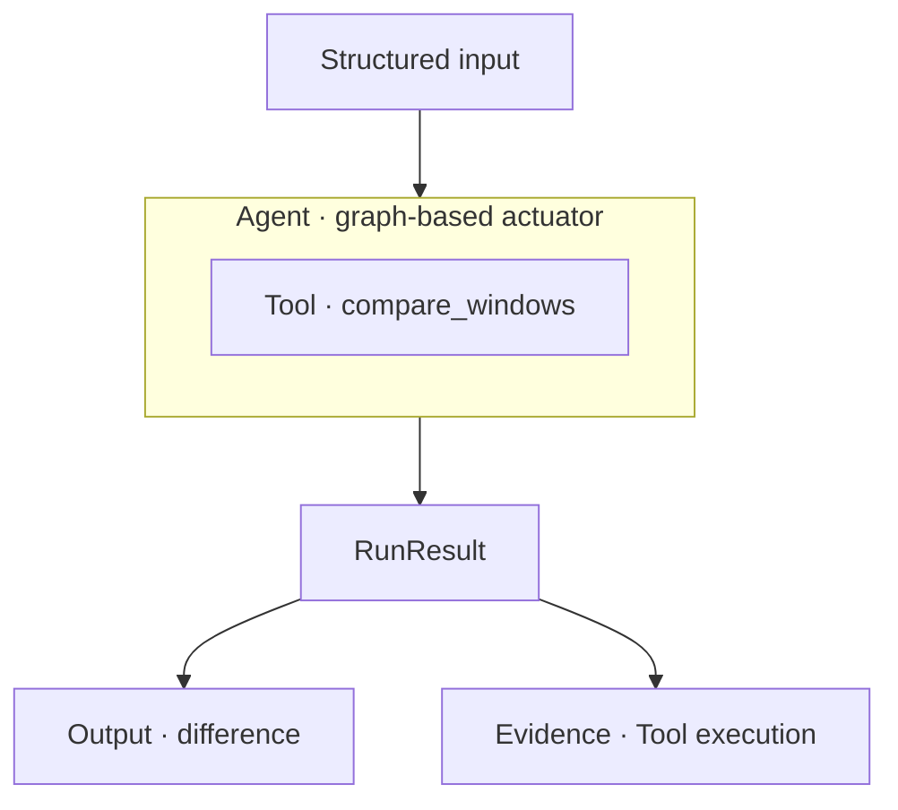
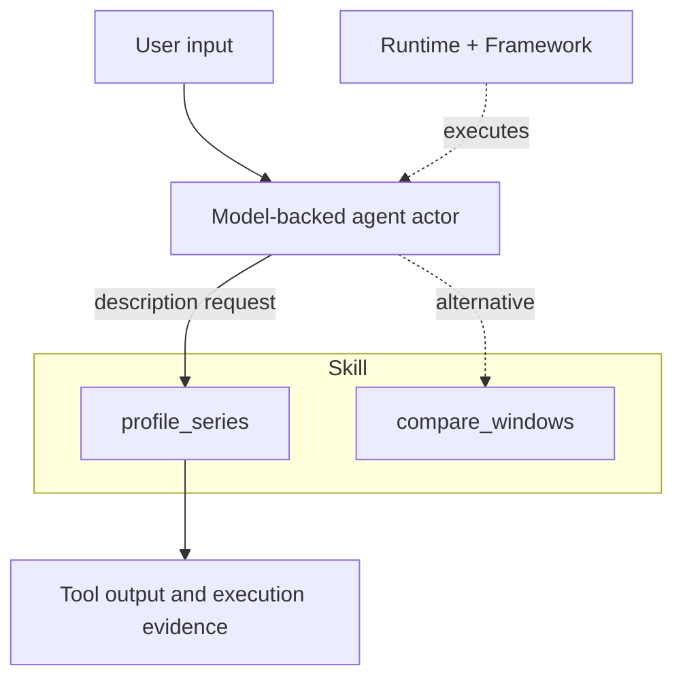
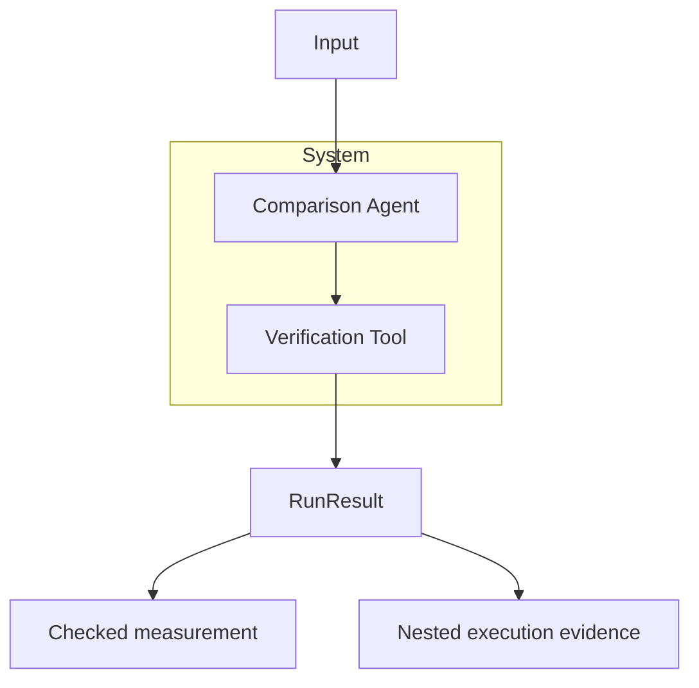
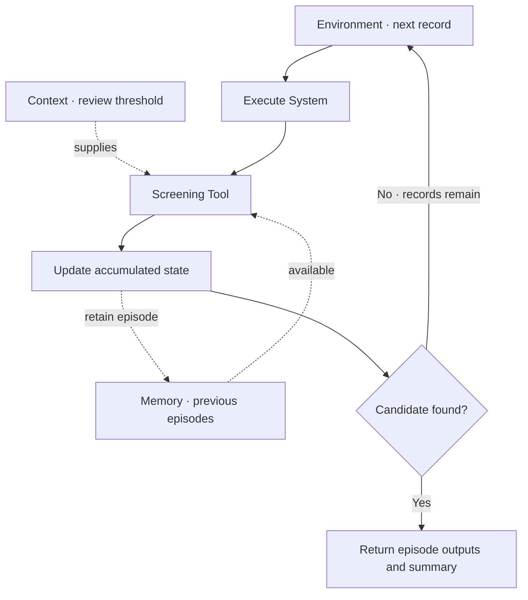
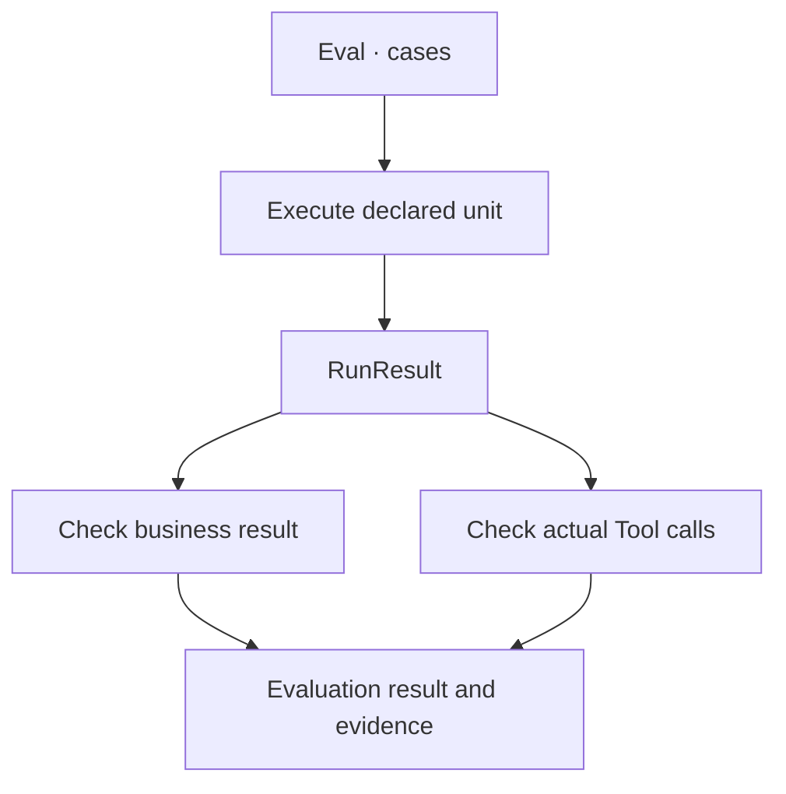

<p align="center">
  
</p>

# Agentic Systems

**Compose tools, model-backed agent actors, and graph-based agent actuators into systems you can inspect and evaluate.**

Agentic Systems is a Python library for combining executable operations, model-selected actions and explicit workflows. Build reusable capabilities, coordinate their work, and check the operations behind each result.

## Why Agentic Systems?

Use it when your application needs to:

- **Combine code and model decisions.** Define operations as Tools, execute them through graphs or let model actors select them.
- **Compose reusable capabilities.** Coordinate Agents and Tools in Systems, then run those workflows over successive inputs.
- **Check what happened.** Inspect execution evidence and evaluate both the outputs and the operations that produced them.

The walkthrough below follows one capability as it grows: execute it, offer a choice of actions, compose a workflow, add episode history, and check the result.

Each interaction shows a request, explains the answer, and then builds the capability behind it. In local examples, the answer text presents the returned data for the reader; the actuators themselves return structured results. The optional model interaction is labeled as expected rather than executed.

[Documentation](https://github.com/JacoboGGLeon/agentic_systems/tree/main/docs) · [Examples](https://github.com/JacoboGGLeon/agentic_systems/tree/main/examples)

## Get started

```bash
pip install "agentic-systems==2.1.9"
```

This guide targets **2.1.9**. During release preparation, install the candidate wheel; the registry command above applies after publication. Run the local examples in order. The model configuration is optional; the following composition and evaluation examples run without model access.

## How it works

Start with one operation you can check: comparing two windows of observations.

Define the calculation as a **Tool**, connect it through a **Graph**, and give that graph to an **Agent**. This creates a **graph-based agent actuator**: a capability that follows the execution path you declared.

**User input**

> My earlier observations are 10 and 10; the later observations are 15 and 15. How much did the average change?

**Agentic Systems output**

The earlier average is **10** and the later average is **15**. The difference is **+5 units**: the later window is higher on average.

**How we build the answer**

We need a numerical comparison with an inspectable calculation. First, `compare_windows` checks that the observations form two equally sized windows and contain finite numbers. It then subtracts the earlier mean from the later mean.

```python
import math
from statistics import mean
from pydantic import BaseModel
import agentic_systems as toolkit

class State(BaseModel):
    values: list[float]
    difference: float | None = None
    verified: bool = False

@toolkit.tool
def compare_windows(values: list[float]) -> dict:
    """Compare the means of equal chronological windows."""
    if len(values) < 4 or len(values) % 2:
        raise ValueError("Two equal windows are required")
    if not all(math.isfinite(v) for v in values):
        raise ValueError("Finite observations are required")
    n = len(values) // 2
    return {"difference": mean(values[n:]) - mean(values[:n])}

```

The calculation now has a name and an input/output boundary. To make it a reusable workflow, use the declared state, connect the Tool between START and END, and give the graph to an Agent.

```python
graph = toolkit.Graph(State)
graph.add_node("compare", compare_windows)
graph.add_edge(toolkit.START, "compare")
graph.add_edge("compare", toolkit.END)
actuator = toolkit.Agent("comparison", graph=graph)

sample = {"values": [10, 10, 15, 15]}
result = actuator.run(sample)
assert result.ok
print(result.data["difference"])
```

The diagram shows two things returned by the same execution: business data for the answer and evidence of the Tool that produced it.



**Returned data**

```text
5.0
```

Here, `5.0` is the `difference` field printed from `result.data`. It means **later mean minus earlier mean**, in the same units as the observations. `result.ok` checks execution success; it does not turn a descriptive difference into a statistical finding.

The question expresses the task; the local actuator receives the `sample` dictionary. You can now reuse this capability in a larger graph.

## Let a model choose an action

The first capability always compares its inputs. To support different requests, add a description Tool and group both operations in a **Skill**.

A **model-backed agent actor** uses the request to select an available Tool. The **Runtime** configures its provider and model. The **Framework** selects how the actor executes.

**User input**

> Describe these observations instead of comparing them: 10, 10, 15, 15.

**Expected Agentic Systems output — model call not executed here**

There are **4 observations**, with an average of **12.5**. For this request, the actor should select `profile_series` rather than compare the two windows.

**How we build the answer**

The user's request now determines which operation is useful. We add `profile_series`, expose both Tools through one Skill, and tell the actor how to choose. The model receives the request; the selected Python Tool performs the arithmetic.

Install the optional integration:

```bash
pip install "agentic-systems[bedrock]==2.1.9"
```

Continue with the comparison Tool above. This configuration uses Bedrock and the environment's AWS credential chain.

```python
import boto3

@toolkit.tool
def profile_series(values: list[float]) -> dict:
    """Describe finite numerical observations."""
    if not values or not all(math.isfinite(v) for v in values):
        raise ValueError("Finite observations are required")
    return {"count": len(values), "average": mean(values)}

skill = toolkit.skill(
    name="series_analysis", tools=(compare_windows, profile_series),
)
runtime = toolkit.runtime(
    provider="bedrock-runtime", model="qwen.qwen3-32b-v1:0",
    session=boto3.Session(region_name="us-east-1"),
    max_turns=1, max_tool_calls=1, max_tokens=256, max_retries=0,
)
actor = toolkit.Agent(
    "analyst", runtime=runtime, framework=toolkit.framework("native"),
    skills=(skill,),
    instructions="Choose one appropriate Tool. Preserve all values. Report its result.",
)
# Live invocation: use the bounded ADA notebook linked below to run and inspect it.
# selected = actor.run("Describe these observations: 10, 10, 15, 15.")
```

The two outgoing paths represent available choices. The description path is the intended choice for this request, not a recorded model selection for this four-value example.



**Expected returned data**

```text
{'count': 4, 'average': 12.5}
```

The expected dictionary contains the Tool's calculated values. To establish that the actor actually used this Tool, inspect its recorded name and arguments in a live run. The linked ADA notebook includes real model executions, selection checks and a persistent HTTP budget.

## Compose capabilities into a System

Once a capability works on its own, make it part of a larger workflow. A **System** coordinates capabilities through a graph and retains the evidence from their nested executions.

Here the System reuses the local comparison actuator and adds a verification Tool. This path runs entirely in Python, so it also works if you skipped the optional model configuration.

**User input**

> You found a difference of 5. Can you check that it matches the original observations before returning the result?

**Agentic Systems output**

The difference is **+5 units**, and the numerical verification passed. Recomputing the means from the original observations agrees with the comparison result.

**How we build the answer**

We can reuse the comparison capability rather than repeat its implementation. The System runs that Agent first, then passes the observations and its measured difference to `verify`. A mismatch raises an error; an agreeing measurement writes `verified=True` into state.

```python
@toolkit.tool
def verify(values: list[float], difference: float) -> dict:
    """Check the difference using an independent sum calculation."""
    n = len(values) // 2
    expected = math.fsum(values[n:]) / n - math.fsum(values[:n]) / n
    if not math.isclose(difference, expected, abs_tol=1e-12):
        raise ValueError("Measurement does not match observations")
    return {"verified": True}

coordination = toolkit.Graph(State)
coordination.add_node("analyze", actuator)
coordination.add_node("verify", verify)
coordination.add_edge(toolkit.START, "analyze")
coordination.add_edge("analyze", "verify")
coordination.add_edge("verify", toolkit.END)
system = toolkit.System("checked_comparison", graph=coordination)
checked = system.run(sample)
assert checked.ok
print(checked.data["difference"], checked.data["verified"])
```

The System boundary contains the coordinated work. Its RunResult retains both the checked measurement and the nested Agent and Tool executions.



**Returned data**

```text
5.0 True
```

The two printed values have separate meanings: `5.0` is the measurement; `True` means the verification Tool agreed with it. This check establishes numerical consistency for these inputs, not a causal explanation or a general guarantee about the model.

The complete example also shows model actors participating through graph callbacks.

## Add context and continuity

Next, apply the workflow to successive segments using the same review rule.

Use **Context** for immutable reference information, such as the review threshold. Attach **Memory** to the review capability to retain bounded episode history. An **Environment** supplies the records, executes each episode, updates accumulated state and decides when to stop.

**User input**

> Apply this comparison to successive segments. Use a review threshold of 3, retain prior observations, and stop when a segment needs review.

**Agentic Systems output**

Processed **2 of 3 segments**. The first difference was **0**. The second was **5**, which met the review threshold of **3**, so the round stopped before the third segment.

**How we build the answer**

A single System run handles one segment. The Environment supplies several records and controls the round. Context holds the threshold, the review System's Memory retains prior episodes, and the accumulated state counts processed records. The `stop` function uses the recorded candidate flag.

```python
class Episode(State):
    candidate: bool = False
    previous_episodes: int = 0

context = toolkit.Context({"review_threshold": 3.0}, sources=("demo-rule-v1",))
memory = toolkit.Memory(capacity=10)

@toolkit.tool
def screen(difference: float, *, context: toolkit.Context) -> dict:
    """Apply the declared descriptive screening rule."""
    return {
        "candidate": abs(difference) >= context.data["review_threshold"],
        "previous_episodes": len(context.episodes),
    }

screen_graph = toolkit.Graph(Episode)
screen_graph.add_node("screen", screen)
screen_graph.add_edge(toolkit.START, "screen")
screen_graph.add_edge("screen", toolkit.END)
review = toolkit.System("review", graph=screen_graph, context=context, memory=memory)

episodes = toolkit.Graph(Episode)
episodes.add_node("analyze", system)
episodes.add_node("screen", review)
episodes.add_edge(toolkit.START, "analyze")
episodes.add_edge("analyze", "screen")
episodes.add_edge("screen", toolkit.END)

def update(state, record, result):
    return {"processed": state["processed"] + 1}

def stop(state, result):
    return result.data["candidate"]

environment = toolkit.Environment(
    "series_round", graph=episodes,
    records=({"values": [10, 10, 10, 10]}, sample, sample),
    state={"processed": 0}, update=update, stop=stop, max_steps=3,
    context=context,
)
round_result = environment.run()
assert round_result.ok
print(round_result.data["summary"]["state"])
```

Follow the loop once per record: execute the System, screen the difference, update state, then decide whether to continue. Context supplies the rule; Memory makes earlier review episodes available.



**Returned data**

```text
{'processed': 2}
```

The printed summary reports how many records were processed. The episode outputs retain each difference, candidate flag and `previous_episodes` count. The first review has no prior episode; the second has one. Reaching this descriptive screening threshold is a reason for review, not a statistical-significance result.

## Inspect and evaluate

The application now produces results across several operations and episodes. How do you check that it did the right work?

A **RunResult** lets you inspect outputs, Tool calls and nested executions. An **Eval** runs an Agent, System or Environment against declared cases and applies your acceptance checks. Here one check verifies the value; another verifies the comparison Tool's original input.

**User input**

> How can I check both the answer and whether the comparison actually used my original observations?

**Agentic Systems output**

Both declared acceptance checks passed: the verified difference is **5**, and exactly one successful `compare_windows` call used the original observations.

**How we build the answer**

Inspecting a RunResult lets you follow one execution. Eval goes further: it executes a declared case and applies repeatable acceptance checks. The result check tests the verified value; the trajectory check finds the actual comparison event and compares its input with the case input.

```python
evidence = checked.evidence()
lineage = checked.lineage()

def result_check(result, case):
    return {"ok": result.data["verified"] and result.data["difference"] == 5.0}

def trajectory_check(result, case):
    calls = [event for run in result.walk() for event in run.tool_events
             if event.name == "compare_windows"]
    return {"ok": len(calls) == 1 and calls[0].ok
            and calls[0].input["values"] == case["input"]["values"]}

evaluation = toolkit.Eval(
    "comparison_acceptance", unit=system,
    cases=({"input": sample, "expected": {"ok": True}},),
    checks=(result_check, trajectory_check),
)
accepted = evaluation.run()
print("Acceptance:", accepted.ok)
```

The checks examine different parts of the same RunResult. A correct value alone does not establish that the required operation ran with the correct inputs.



**Returned data**

```text
Acceptance: True
```

`Acceptance: True` means this case satisfied the declared checks. These checks cover the four-value teaching example; they do not certify all inputs. The complete notebook adds negative controls and real-data checks. Use `check_invariants()` separately to inspect structural consistency.

## Build with ChatGPT or Codex

The version-matched **authoring Skill** gives your coding assistant API guidance, examples and validation practices for building Agentic Systems applications.

**[Download the authoring Skill ZIP · 2.1.9](https://github.com/JacoboGGLeon/agentic_systems/releases/download/v2.1.9/agentic-systems-skill-2.1.9.zip)**

The 2.1.9 download becomes available when its GitHub release is published. Before publication, export it from the installed candidate.

Use the ZIP as authoring material in a skill-capable ChatGPT workspace. For Codex, install the bundled Skill from your project directory:

```bash
agentic-systems skill info
agentic-systems skill install
```

The default installation location is `.agents/skills/agentic-systems`. You can also export the same bundled material:

```bash
agentic-systems skill export agentic-systems-skill-2.1.9.zip
```

For example, ask your assistant: “Use the Agentic Systems skill to build a Tool, compose it in a System, and add a result and trajectory evaluation.”

The authoring Skill helps you write applications. Runtime `toolkit.skill(...)` groups the Tools available to an application's actors. Installing or exporting the authoring material does not automatically install it into your ChatGPT account.

## Continue building

| Goal | Resource |
|---|---|
| Run the complete real-data application | [Time-series notebook](https://github.com/JacoboGGLeon/agentic_systems/blob/main/examples/time_series_discovery_219/ADA_Time_Series_Discovery_219_Core.ipynb) |
| Inspect actual saved outputs | [Recorded execution viewer](https://github.com/JacoboGGLeon/agentic_systems/blob/main/examples/time_series_discovery_219/Recorded_Outputs.ipynb) |
| Learn the grammar | [Concepts](https://github.com/JacoboGGLeon/agentic_systems/blob/main/docs/CONCEPTS.md) |
| Configure providers and frameworks | [Integrations](https://github.com/JacoboGGLeon/agentic_systems/blob/main/docs/INTEGRATIONS.md) |
| Build acceptance checks | [Evaluation](https://github.com/JacoboGGLeon/agentic_systems/blob/main/docs/EVALUATION.md) |

The local walkthrough runs without model inference. The optional actor configuration introduces model-selected actions; its live invocation is kept in the bounded notebook. The application notebook targets 2.1.9. The recorded execution viewer preserves actual 2.1.8 outputs and failures as historical evidence; those runs are not certification of the 2.1.9 candidate.

You can start with a single capability and add the pieces your application needs. Explicit Agent contracts and policies are outside this introductory walkthrough.
