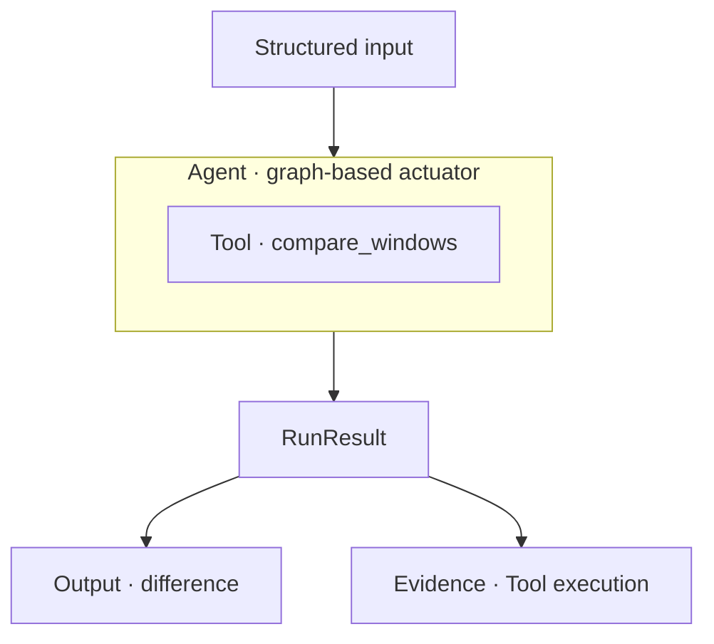
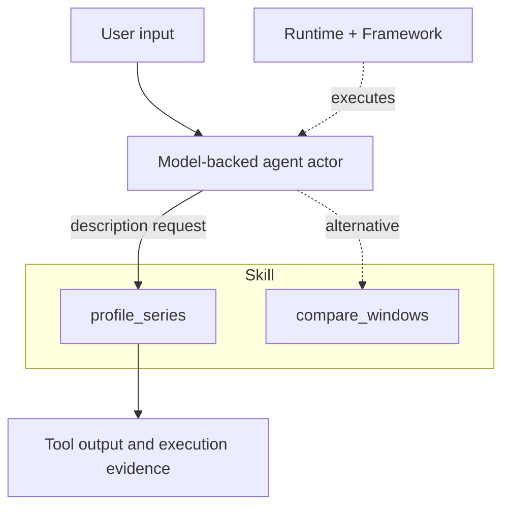
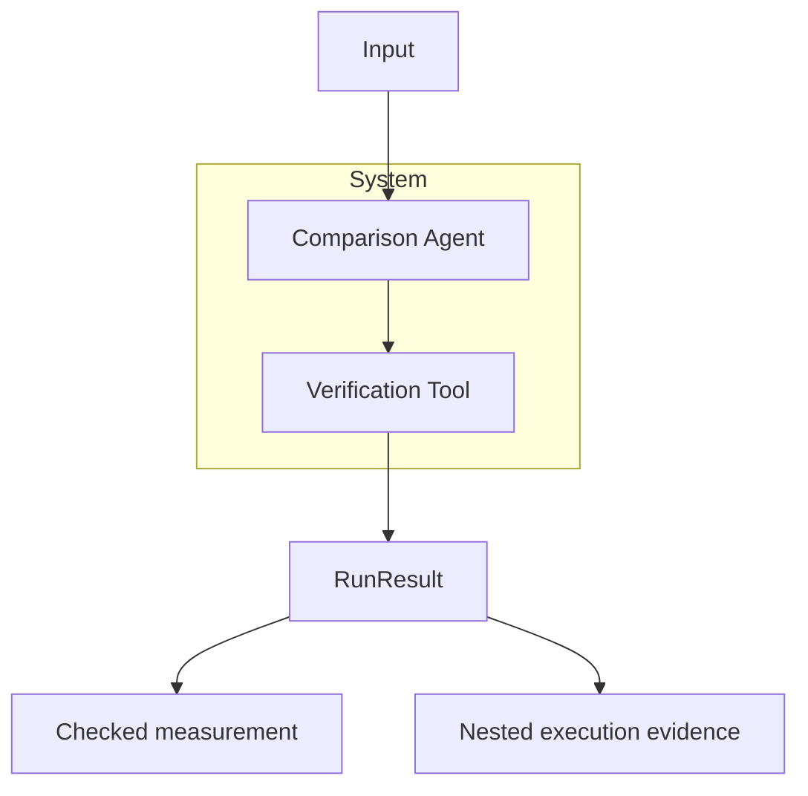
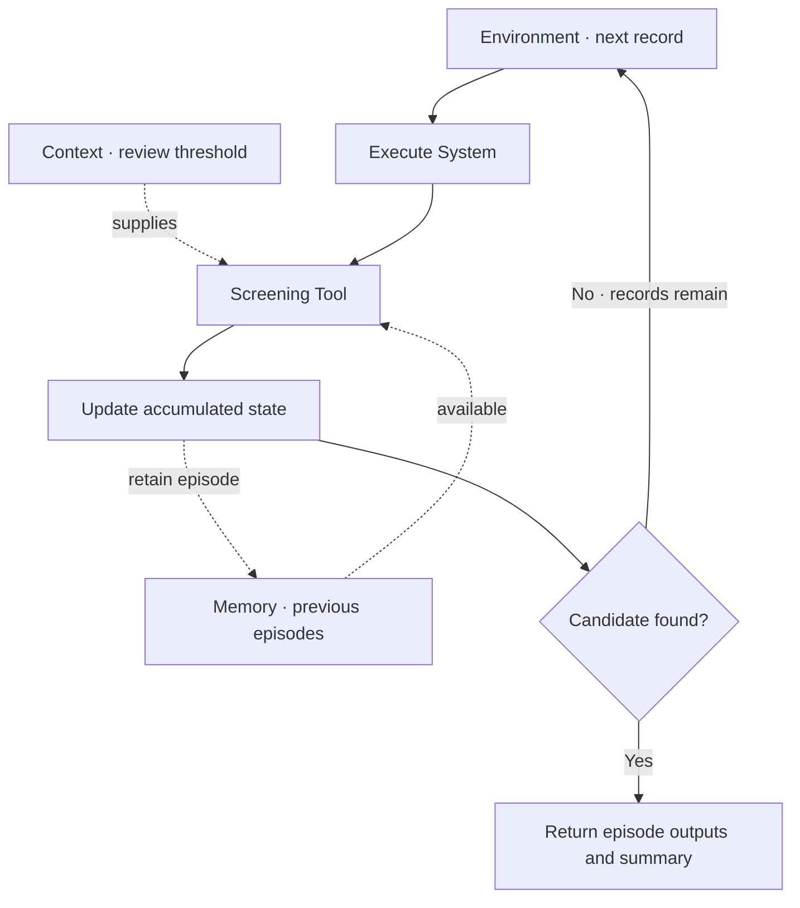
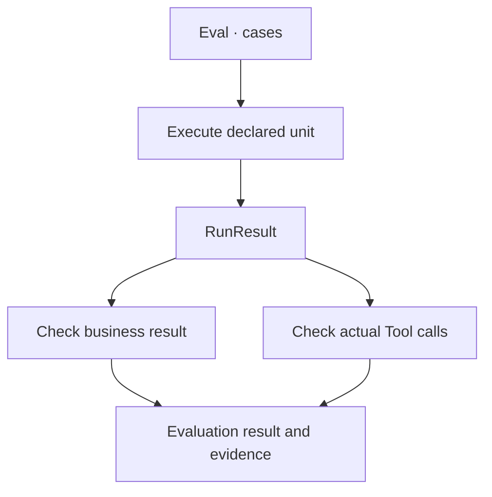

<p align="center">
  
</p>

# Agentic Systems

**Compose tools, model-backed agent actors, and graph-based agent actuators into systems you can inspect and evaluate.**

Agentic Systems is a Python library for combining executable operations, model-selected actions and explicit workflows. Build reusable capabilities, coordinate their work, and check the operations behind each result.

## Why Agentic Systems?

Use it when your application needs to:

- **Combine code and model decisions.** Define operations as Tools, execute them through graphs or let model actors select them.
- **Compose reusable capabilities.** Coordinate Agents and Tools in Systems, then run those workflows over successive inputs.
- **Check what happened.** Inspect execution evidence and evaluate both the outputs and the operations that produced them.

The walkthrough below follows one capability as it grows: execute it, offer a choice of actions, compose a workflow, add episode history, and check the result.

[Documentation](https://github.com/JacoboGGLeon/agentic_systems/tree/main/docs) · [Examples](https://github.com/JacoboGGLeon/agentic_systems/tree/main/examples)

## Get started

```bash
pip install "agentic-systems==2.1.8"
```

The examples below target SDK 2.1.8, the verified baseline for the 2.1.9 documentation proposal. Run the local blocks in order. Block 2 is an optional Bedrock configuration; blocks 3–5 reuse the local actuator and need no model access.

## How it works

Start with one operation you can check: comparing two windows of observations.

Define the calculation as a **Tool**, connect it through a **Graph**, and give that graph to an **Agent**. This creates a **graph-based agent actuator**: a capability that follows the execution path you declared.

**User input**

> Compare the earlier and later observations.

```python
import math
from statistics import mean
from pydantic import BaseModel
import agentic_systems as toolkit

class State(BaseModel):
    values: list[float]
    difference: float | None = None
    verified: bool = False

@toolkit.tool
def compare_windows(values: list[float]) -> dict:
    """Compare the means of equal chronological windows."""
    if len(values) < 4 or len(values) % 2:
        raise ValueError("Two equal windows are required")
    if not all(math.isfinite(v) for v in values):
        raise ValueError("Finite observations are required")
    n = len(values) // 2
    return {"difference": mean(values[n:]) - mean(values[:n])}

graph = toolkit.Graph(State)
graph.add_node("compare", compare_windows)
graph.add_edge(toolkit.START, "compare")
graph.add_edge("compare", toolkit.END)
actuator = toolkit.Agent("comparison", graph=graph)

sample = {"values": [10, 10, 15, 15]}
result = actuator.run(sample)
assert result.ok
print(result.data["difference"])
```



**Agentic Systems output**

```text
5.0
```

The Tool calculated the difference, the Graph determined the execution path, and the Agent returned a **RunResult** containing the output and execution evidence. You can now run this capability independently or reuse it inside another graph.

The question introduces the task; the actuator itself receives structured values. These illustrative observations support a descriptive comparison.

## Let a model choose an action

The first capability always compares its inputs. To support different requests, add a description Tool and group both operations in a **Skill**.

A **model-backed agent actor** uses the request to select an available Tool. The **Runtime** configures its provider and model. The **Framework** selects how the actor executes.

**User input**

> Describe these observations instead of comparing them: 10, 10, 15, 15.

Install the optional integration:

```bash
pip install "agentic-systems[bedrock]==2.1.8"
```

Continue with the comparison Tool above. This configuration uses Bedrock and the environment's AWS credential chain.

```python
import boto3

@toolkit.tool
def profile_series(values: list[float]) -> dict:
    """Describe finite numerical observations."""
    if not values or not all(math.isfinite(v) for v in values):
        raise ValueError("Finite observations are required")
    return {"count": len(values), "average": mean(values)}

skill = toolkit.skill(
    name="series_analysis", tools=(compare_windows, profile_series),
)
runtime = toolkit.runtime(
    provider="bedrock-runtime", model="qwen.qwen3-32b-v1:0",
    session=boto3.Session(region_name="us-east-1"),
    max_turns=1, max_tool_calls=1, max_tokens=256, max_retries=0,
)
actor = toolkit.Agent(
    "analyst", runtime=runtime, framework=toolkit.framework("native"),
    skills=(skill,),
    instructions="Choose one appropriate Tool. Preserve all values. Report its result.",
)
# Live invocation: use the bounded ADA notebook linked below to run and inspect it.
# selected = actor.run("Describe these observations: 10, 10, 15, 15.")
```



**Expected Tool output — this four-value model call is not run here**

```text
{'count': 4, 'average': 12.5}
```

The model selects the operation; the Tool calculates. Instructions alone do not guarantee selection: inspect the actual Tool event. The complete ADA example includes real model runs, a persistent HTTP budget and selection checks.

## Compose capabilities into a System

Once a capability works on its own, make it part of a larger workflow. A **System** coordinates capabilities through a graph and retains the evidence from their nested executions.

Here the System reuses the local comparison actuator and adds a verification Tool. This path runs entirely in Python, so it also works if you skipped the optional model configuration.

**User input**

> Compare the observations and verify the measurement.

```python
@toolkit.tool
def verify(values: list[float], difference: float) -> dict:
    """Check the difference using an independent sum calculation."""
    n = len(values) // 2
    expected = math.fsum(values[n:]) / n - math.fsum(values[:n]) / n
    if not math.isclose(difference, expected, abs_tol=1e-12):
        raise ValueError("Measurement does not match observations")
    return {"verified": True}

coordination = toolkit.Graph(State)
coordination.add_node("analyze", actuator)
coordination.add_node("verify", verify)
coordination.add_edge(toolkit.START, "analyze")
coordination.add_edge("analyze", "verify")
coordination.add_edge("verify", toolkit.END)
system = toolkit.System("checked_comparison", graph=coordination)
checked = system.run(sample)
assert checked.ok
print(checked.data["difference"], checked.data["verified"])
```



**Agentic Systems output**

```text
5.0 True
```

The System returns the measurement and its verification together. Its result also retains the Agent and Tool executions, so you can inspect how the answer was produced. The complete example shows how model actors participate through graph callbacks.

## Add context and continuity

Next, apply the workflow to successive segments using the same review rule.

Use **Context** for immutable reference information, such as the review threshold. Attach **Memory** to the review capability to retain bounded episode history. An **Environment** supplies the records, executes each episode, updates accumulated state and decides when to stop.

**User input**

> Process successive segments. Keep prior observations available and stop when the difference reaches the review threshold.

```python
class Episode(State):
    candidate: bool = False
    previous_episodes: int = 0

context = toolkit.Context({"review_threshold": 3.0}, sources=("demo-rule-v1",))
memory = toolkit.Memory(capacity=10)

@toolkit.tool
def screen(difference: float, *, context: toolkit.Context) -> dict:
    """Apply the declared descriptive screening rule."""
    return {
        "candidate": abs(difference) >= context.data["review_threshold"],
        "previous_episodes": len(context.episodes),
    }

screen_graph = toolkit.Graph(Episode)
screen_graph.add_node("screen", screen)
screen_graph.add_edge(toolkit.START, "screen")
screen_graph.add_edge("screen", toolkit.END)
review = toolkit.System("review", graph=screen_graph, context=context, memory=memory)

episodes = toolkit.Graph(Episode)
episodes.add_node("analyze", system)
episodes.add_node("screen", review)
episodes.add_edge(toolkit.START, "analyze")
episodes.add_edge("analyze", "screen")
episodes.add_edge("screen", toolkit.END)

def update(state, record, result):
    return {"processed": state["processed"] + 1}

def stop(state, result):
    return result.data["candidate"]

environment = toolkit.Environment(
    "series_round", graph=episodes,
    records=({"values": [10, 10, 10, 10]}, sample, sample),
    state={"processed": 0}, update=update, stop=stop, max_steps=3,
    context=context,
)
round_result = environment.run()
assert round_result.ok
print(round_result.data["summary"]["state"])
```



**Agentic Systems output**

```text
{'processed': 2}
```

The first segment has difference 0; the second has difference 5 and triggers the threshold of 3. The third record is not processed. Memory is process-local; reference information, episode history and accumulated state have separate responsibilities.

## Inspect and evaluate

The application now produces results across several operations and episodes. How do you check that it did the right work?

A **RunResult** lets you inspect outputs, Tool calls and nested executions. An **Eval** runs an Agent, System or Environment against declared cases and applies your acceptance checks. Here one check verifies the value; another verifies the comparison Tool's original input.

**User input**

> Verify the result and confirm that comparison used the original observations.

```python
evidence = checked.evidence()
lineage = checked.lineage()

def result_check(result, case):
    return {"ok": result.data["verified"] and result.data["difference"] == 5.0}

def trajectory_check(result, case):
    calls = [event for run in result.walk() for event in run.tool_events
             if event.name == "compare_windows"]
    return {"ok": len(calls) == 1 and calls[0].ok
            and calls[0].input["values"] == case["input"]["values"]}

evaluation = toolkit.Eval(
    "comparison_acceptance", unit=system,
    cases=({"input": sample, "expected": {"ok": True}},),
    checks=(result_check, trajectory_check),
)
accepted = evaluation.run()
print("Acceptance:", accepted.ok)
```



**Agentic Systems output**

```text
Acceptance: True
```

This check is specific to the four-value teaching case. The complete example adds negative controls and real-data checks. Structural consistency can be inspected separately with `result.check_invariants()`.

## Continue building

| Goal | Resource |
|---|---|
| Run the complete real-data application | [Time-series notebook](https://github.com/JacoboGGLeon/agentic_systems/blob/docs/2.1.9-readme-preview/examples/time_series_discovery_219/ADA_Time_Series_Discovery_219_Core.ipynb) |
| Inspect actual saved outputs | [Recorded execution viewer](https://github.com/JacoboGGLeon/agentic_systems/blob/docs/2.1.9-readme-preview/examples/time_series_discovery_219/Recorded_Outputs.ipynb) |
| Learn the grammar | [Concepts](https://github.com/JacoboGGLeon/agentic_systems/blob/main/docs/CONCEPTS.md) |
| Configure providers and frameworks | [Integrations](https://github.com/JacoboGGLeon/agentic_systems/blob/main/docs/INTEGRATIONS.md) |
| Build acceptance checks | [Evaluation](https://github.com/JacoboGGLeon/agentic_systems/blob/main/docs/EVALUATION.md) |

The local walkthrough runs without model inference. The optional actor configuration introduces model-selected actions; its live invocation is kept in the bounded notebook. That notebook records exact SDK versions, actual outputs and failures.

You can start with a single capability and add the pieces your application needs. Explicit Agent contracts and policies are outside this introductory walkthrough.
