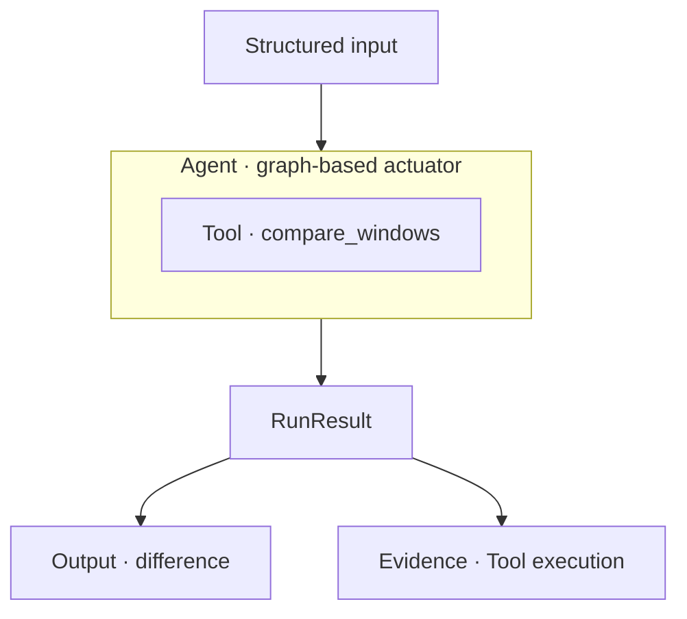
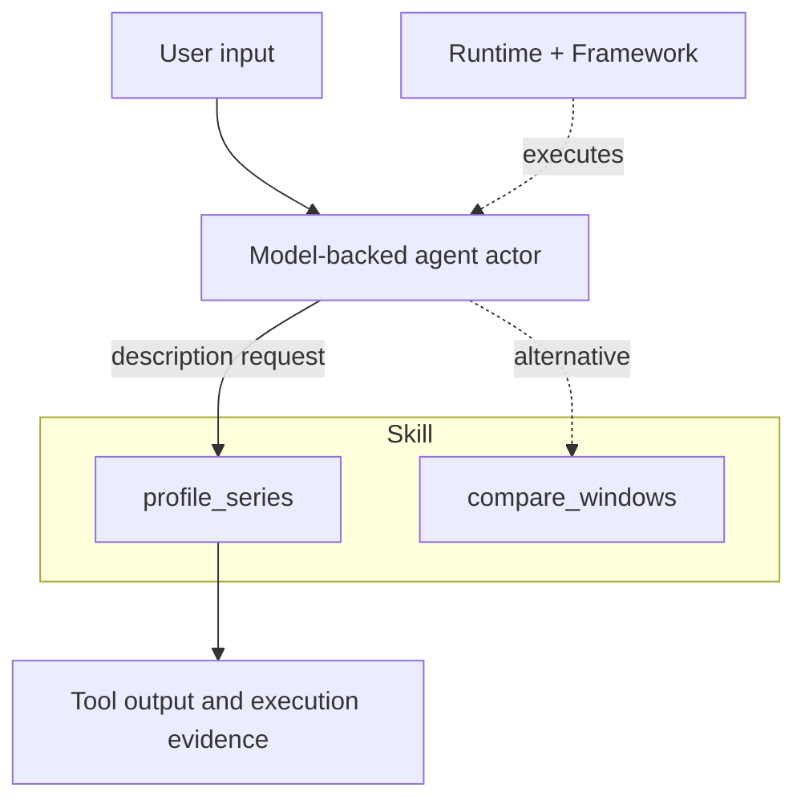
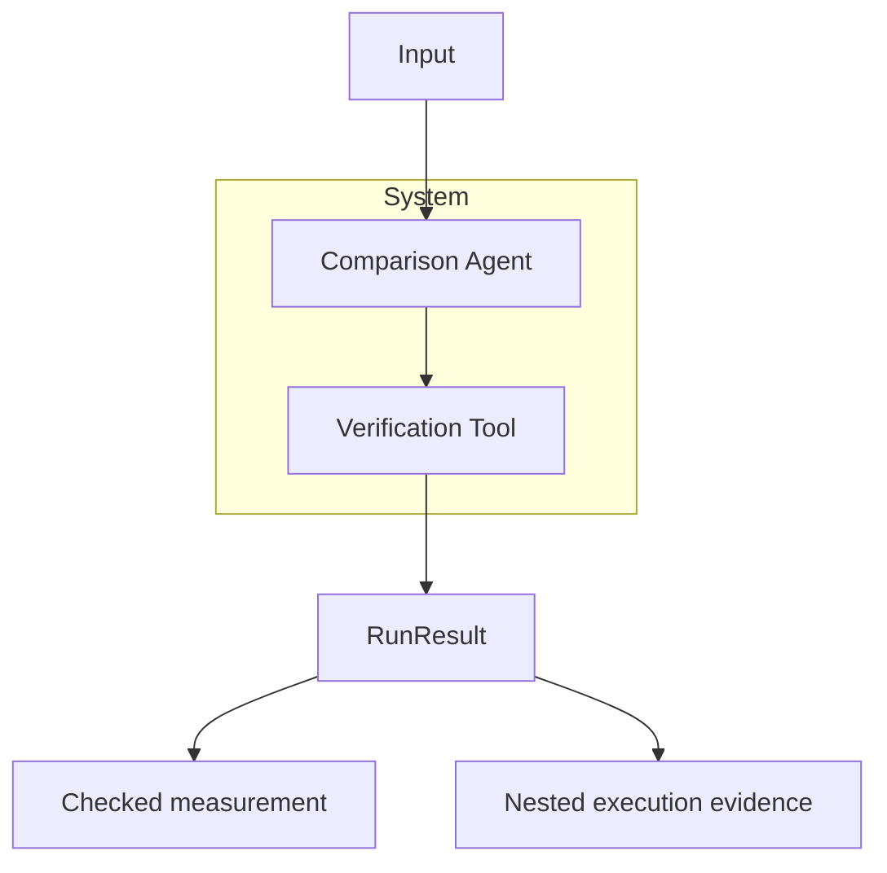
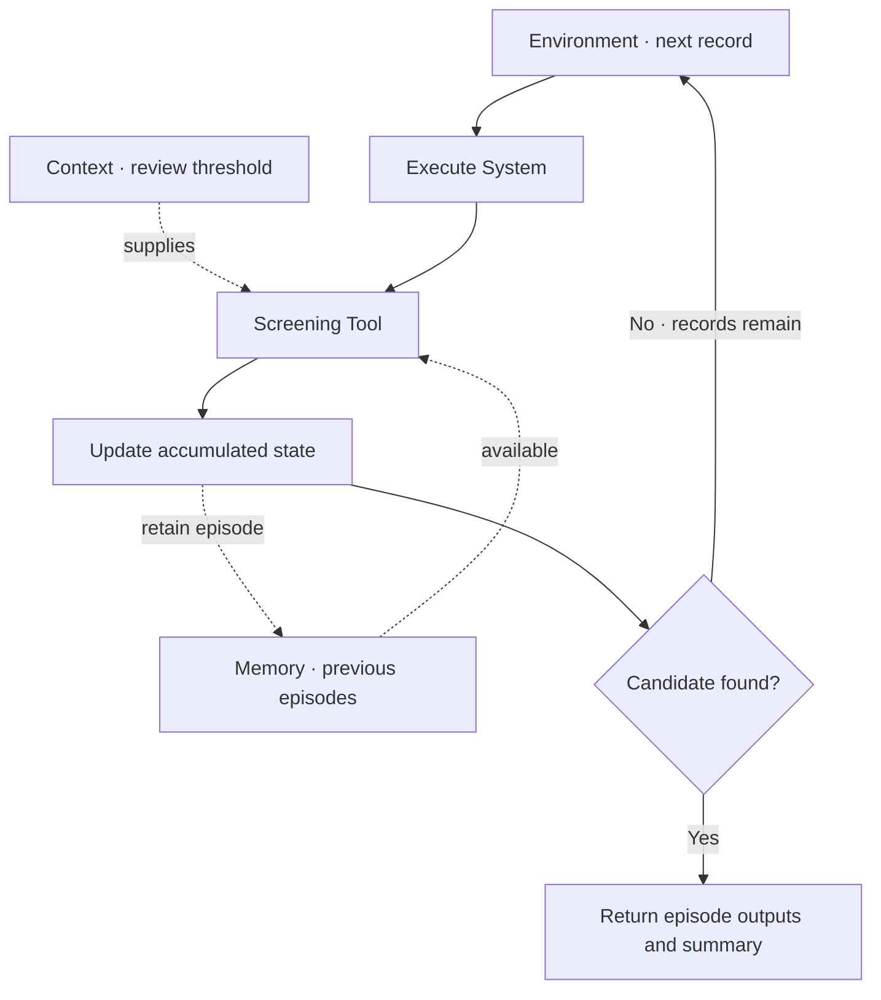
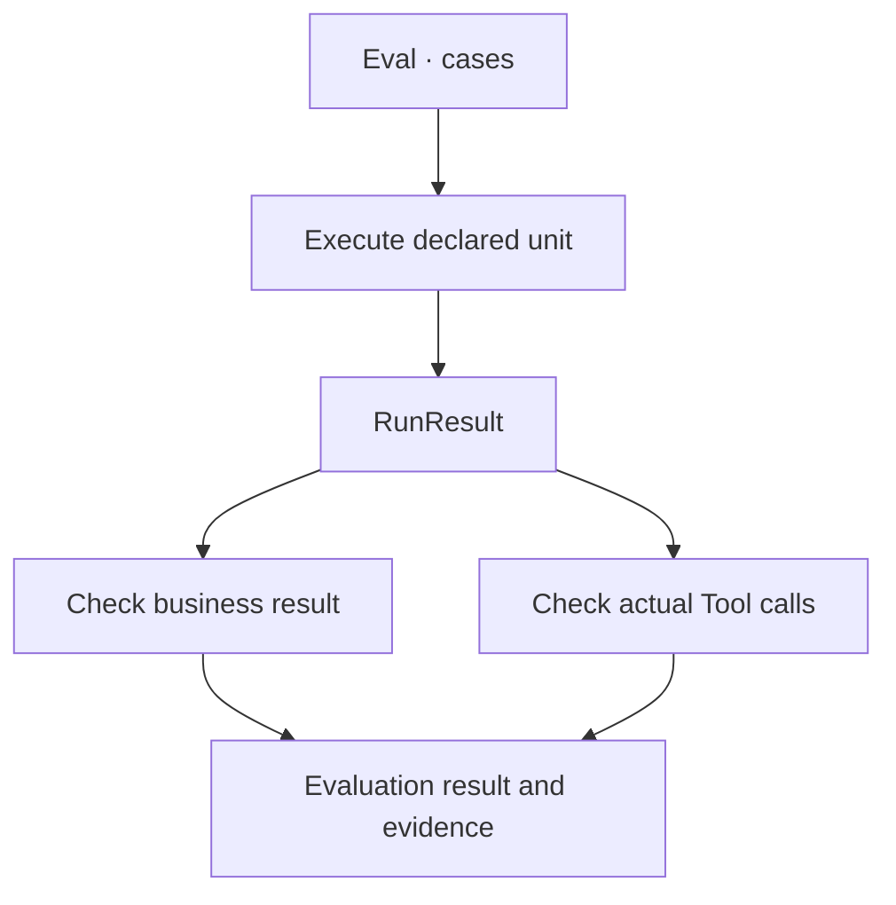

<p align="center">
  
</p>

# Agentic Systems

**Compose tools, model-backed agent actors, and graph-based agent actuators into systems you can inspect and evaluate.**

Agentic Systems is a Python library for combining executable operations, model-selected actions and explicit workflows. Build reusable capabilities, coordinate their work, and check the operations behind each result.

Use it to build tool-using assistants, analytical workflows and applications that combine model decisions with deterministic code.

[Documentation](https://github.com/JacoboGGLeon/agentic_systems/tree/main/docs) · [Examples](https://github.com/JacoboGGLeon/agentic_systems/tree/main/examples)

## Install

```bash
pip install "agentic-systems==2.1.8"
```

The examples below target SDK 2.1.8, the verified baseline for the 2.1.9 documentation proposal. Run the local blocks in order. Block 2 is an optional Bedrock configuration; blocks 3–5 reuse the local actuator and need no model access.

## 1. Define and run a capability

A **Tool** executes an operation. A **Graph** declares its execution path. An **Agent(graph=...)** owns that workflow: a graph-based agent actuator.

**User input**

> Compare the earlier and later observations.

```python
import math
from statistics import mean
from pydantic import BaseModel
import agentic_systems as toolkit

class State(BaseModel):
    values: list[float]
    difference: float | None = None
    verified: bool = False

@toolkit.tool
def compare_windows(values: list[float]) -> dict:
    """Compare the means of equal chronological windows."""
    if len(values) < 4 or len(values) % 2:
        raise ValueError("Two equal windows are required")
    if not all(math.isfinite(v) for v in values):
        raise ValueError("Finite observations are required")
    n = len(values) // 2
    return {"difference": mean(values[n:]) - mean(values[:n])}

graph = toolkit.Graph(State)
graph.add_node("compare", compare_windows)
graph.add_edge(toolkit.START, "compare")
graph.add_edge("compare", toolkit.END)
actuator = toolkit.Agent("comparison", graph=graph)

sample = {"values": [10, 10, 15, 15]}
result = actuator.run(sample)
assert result.ok
print(result.data["difference"])
```



**Agentic Systems output**

```text
5.0
```

The request explains the task; this actuator receives structured values. These are illustrative observations, and the difference is descriptive.

## 2. Let a model select the action

A **Skill** groups Tools. A model-backed agent actor chooses an action from its available capabilities. **Runtime** configures the provider and model; **Framework** selects how the actor executes.

**User input**

> Describe these observations instead of comparing them: 10, 10, 15, 15.

Install the optional integration:

```bash
pip install "agentic-systems[bedrock]==2.1.8"
```

Continue with the Tool from block 1. This configuration uses Bedrock and the environment's AWS credential chain.

```python
import boto3

@toolkit.tool
def profile_series(values: list[float]) -> dict:
    """Describe finite numerical observations."""
    if not values or not all(math.isfinite(v) for v in values):
        raise ValueError("Finite observations are required")
    return {"count": len(values), "average": mean(values)}

skill = toolkit.skill(
    name="series_analysis", tools=(compare_windows, profile_series),
)
runtime = toolkit.runtime(
    provider="bedrock-runtime", model="qwen.qwen3-32b-v1:0",
    session=boto3.Session(region_name="us-east-1"),
    max_turns=1, max_tool_calls=1, max_tokens=256, max_retries=0,
)
actor = toolkit.Agent(
    "analyst", runtime=runtime, framework=toolkit.framework("native"),
    skills=(skill,),
    instructions="Choose one appropriate Tool. Preserve all values. Report its result.",
)
# Live invocation: use the bounded ADA notebook linked below to run and inspect it.
# selected = actor.run("Describe these observations: 10, 10, 15, 15.")
```



**Expected Tool output — this four-value model call is not run here**

```text
{'count': 4, 'average': 12.5}
```

The model selects the operation; the Tool calculates. Instructions alone do not guarantee selection: inspect the actual Tool event. The complete ADA example includes real model runs, a persistent HTTP budget and selection checks.

## 3. Compose capabilities into a System

A **System** coordinates capabilities through a graph and retains their nested evidence. Here it reuses the local actuator and adds an independent numerical check.

**User input**

> Compare the observations and verify the measurement.

```python
@toolkit.tool
def verify(values: list[float], difference: float) -> dict:
    """Check the difference using an independent sum calculation."""
    n = len(values) // 2
    expected = math.fsum(values[n:]) / n - math.fsum(values[:n]) / n
    if not math.isclose(difference, expected, abs_tol=1e-12):
        raise ValueError("Measurement does not match observations")
    return {"verified": True}

coordination = toolkit.Graph(State)
coordination.add_node("analyze", actuator)
coordination.add_node("verify", verify)
coordination.add_edge(toolkit.START, "analyze")
coordination.add_edge("analyze", "verify")
coordination.add_edge("verify", toolkit.END)
system = toolkit.System("checked_comparison", graph=coordination)
checked = system.run(sample)
assert checked.ok
print(checked.data["difference"], checked.data["verified"])
```



**Agentic Systems output**

```text
5.0 True
```

The graph makes coordination explicit. A model actor can also participate through a graph callback, as shown in the complete example.

## 4. Add context and run episodes

**Context** supplies immutable reference information. **Memory** retains bounded episode history. An **Environment** executes a graph over records, updates accumulated state and applies a stopping rule.

**User input**

> Process successive segments. Keep prior observations available and stop when the difference reaches the review threshold.

```python
class Episode(State):
    candidate: bool = False
    previous_episodes: int = 0

context = toolkit.Context({"review_threshold": 3.0}, sources=("demo-rule-v1",))
memory = toolkit.Memory(capacity=10)

@toolkit.tool
def screen(difference: float, *, context: toolkit.Context) -> dict:
    """Apply the declared descriptive screening rule."""
    return {
        "candidate": abs(difference) >= context.data["review_threshold"],
        "previous_episodes": len(context.episodes),
    }

screen_graph = toolkit.Graph(Episode)
screen_graph.add_node("screen", screen)
screen_graph.add_edge(toolkit.START, "screen")
screen_graph.add_edge("screen", toolkit.END)
review = toolkit.System("review", graph=screen_graph, context=context, memory=memory)

episodes = toolkit.Graph(Episode)
episodes.add_node("analyze", system)
episodes.add_node("screen", review)
episodes.add_edge(toolkit.START, "analyze")
episodes.add_edge("analyze", "screen")
episodes.add_edge("screen", toolkit.END)

def update(state, record, result):
    return {"processed": state["processed"] + 1}

def stop(state, result):
    return result.data["candidate"]

environment = toolkit.Environment(
    "series_round", graph=episodes,
    records=({"values": [10, 10, 10, 10]}, sample, sample),
    state={"processed": 0}, update=update, stop=stop, max_steps=3,
    context=context,
)
round_result = environment.run()
assert round_result.ok
print(round_result.data["summary"]["state"])
```



**Agentic Systems output**

```text
{'processed': 2}
```

The first segment has difference 0; the second has difference 5 and triggers the threshold of 3. The third record is not processed. Memory is process-local; reference information, episode history and accumulated state have separate responsibilities.

## 5. Inspect and evaluate the execution

Every execution returns a **RunResult**. Inspect its evidence, or use **Eval** to execute acceptance cases against an Agent, System or Environment.

**User input**

> Verify the result and confirm that comparison used the original observations.

```python
evidence = checked.evidence()
lineage = checked.lineage()

def result_check(result, case):
    return {"ok": result.data["verified"] and result.data["difference"] == 5.0}

def trajectory_check(result, case):
    calls = [event for run in result.walk() for event in run.tool_events
             if event.name == "compare_windows"]
    return {"ok": len(calls) == 1 and calls[0].ok
            and calls[0].input["values"] == case["input"]["values"]}

evaluation = toolkit.Eval(
    "comparison_acceptance", unit=system,
    cases=({"input": sample, "expected": {"ok": True}},),
    checks=(result_check, trajectory_check),
)
accepted = evaluation.run()
print("Acceptance:", accepted.ok)
```



**Agentic Systems output**

```text
Acceptance: True
```

This check is specific to the four-value teaching case. The complete example adds negative controls and real-data checks. Structural consistency can be inspected separately with `result.check_invariants()`.

## Continue building

| Goal | Resource |
|---|---|
| Run the complete real-data application | [Time-series notebook](https://github.com/JacoboGGLeon/agentic_systems/blob/docs/2.1.9-readme-preview/examples/time_series_discovery_219/ADA_Time_Series_Discovery_219_Core.ipynb) |
| Inspect actual saved outputs | [Recorded execution viewer](https://github.com/JacoboGGLeon/agentic_systems/blob/docs/2.1.9-readme-preview/examples/time_series_discovery_219/Recorded_Outputs.ipynb) |
| Learn the grammar | [Concepts](https://github.com/JacoboGGLeon/agentic_systems/blob/main/docs/CONCEPTS.md) |
| Configure providers and frameworks | [Integrations](https://github.com/JacoboGGLeon/agentic_systems/blob/main/docs/INTEGRATIONS.md) |
| Build acceptance checks | [Evaluation](https://github.com/JacoboGGLeon/agentic_systems/blob/main/docs/EVALUATION.md) |

The local examples above run without model inference. Live outputs vary by model and configuration. The real-data notebook records its exact SDK version and keeps failures visible. Explicit Agent contracts and policies are outside this introductory walkthrough.
