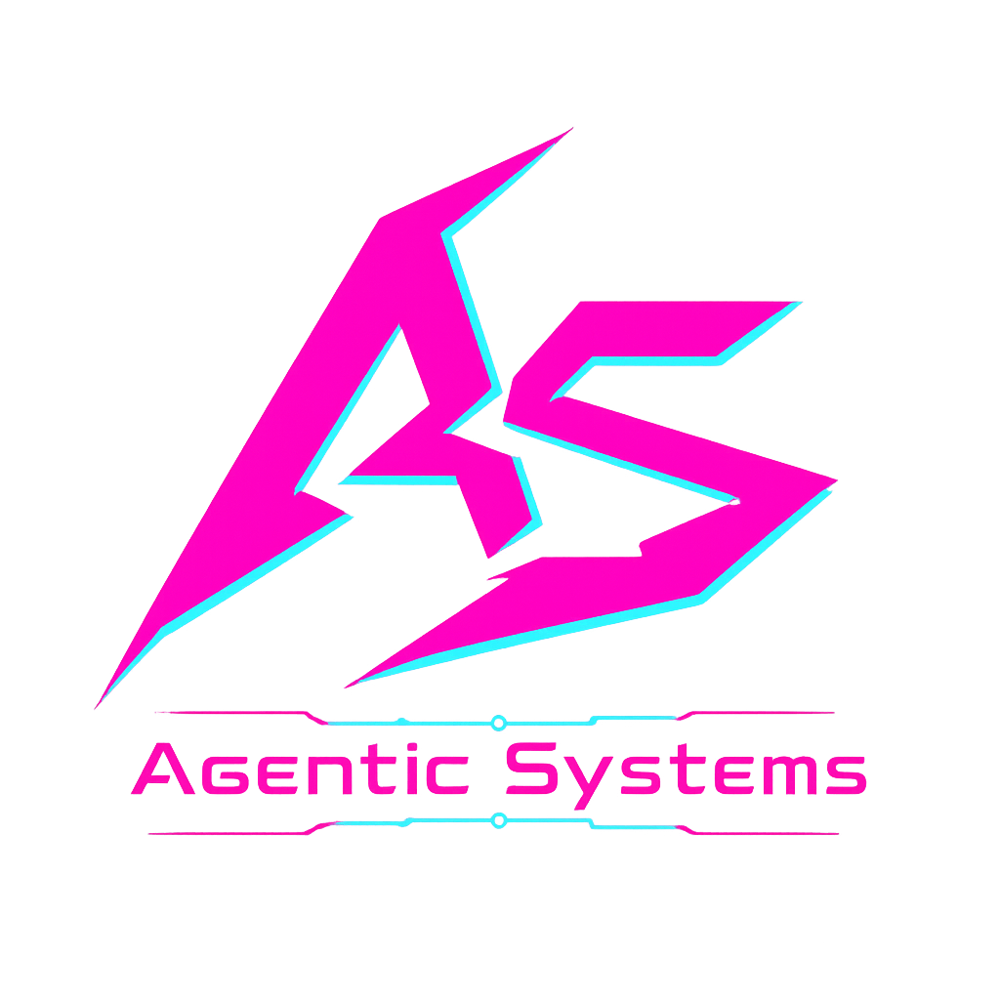
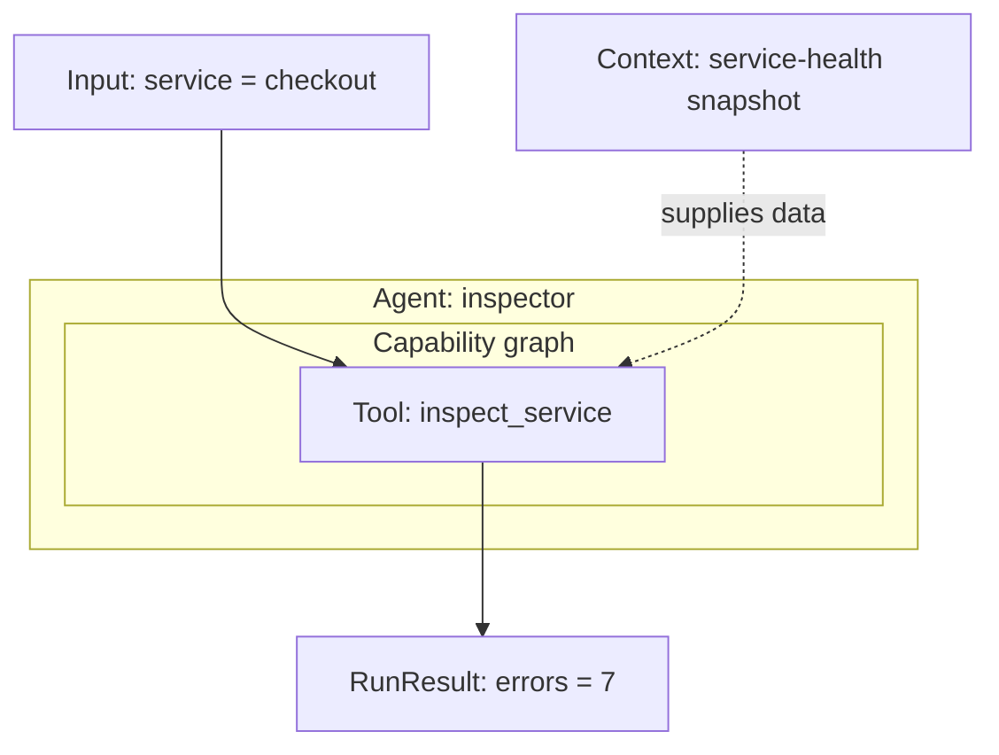
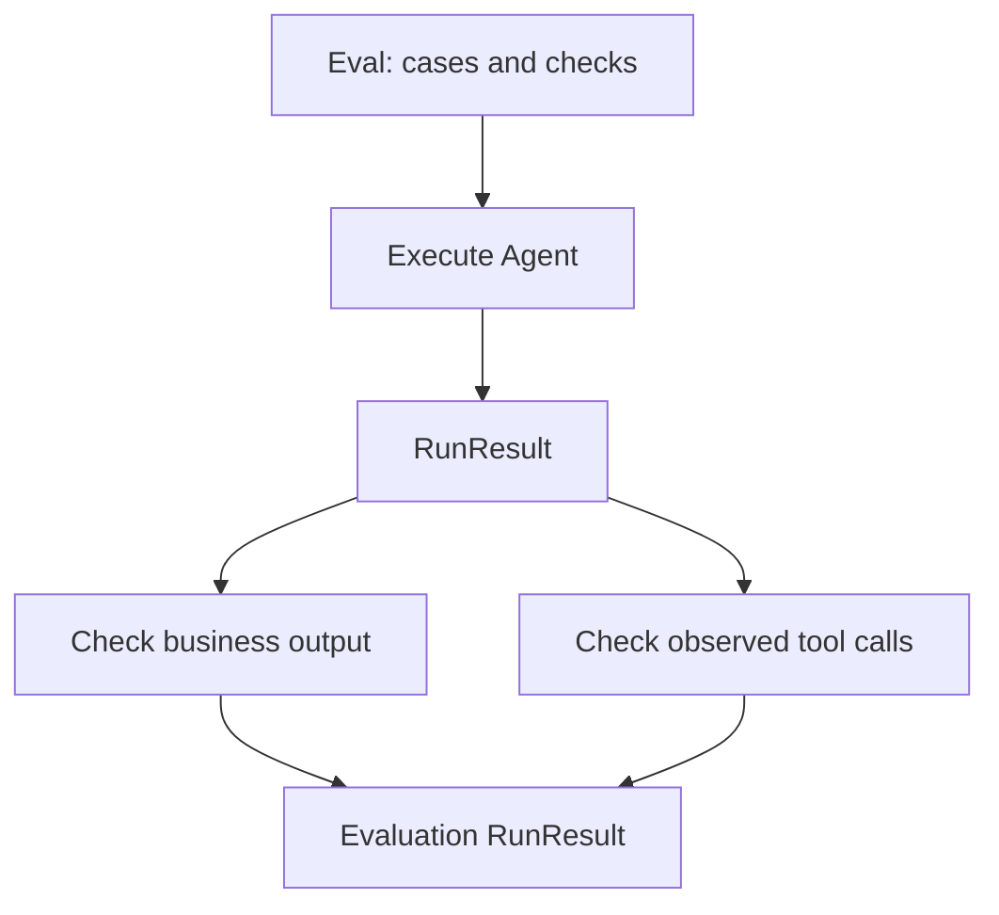
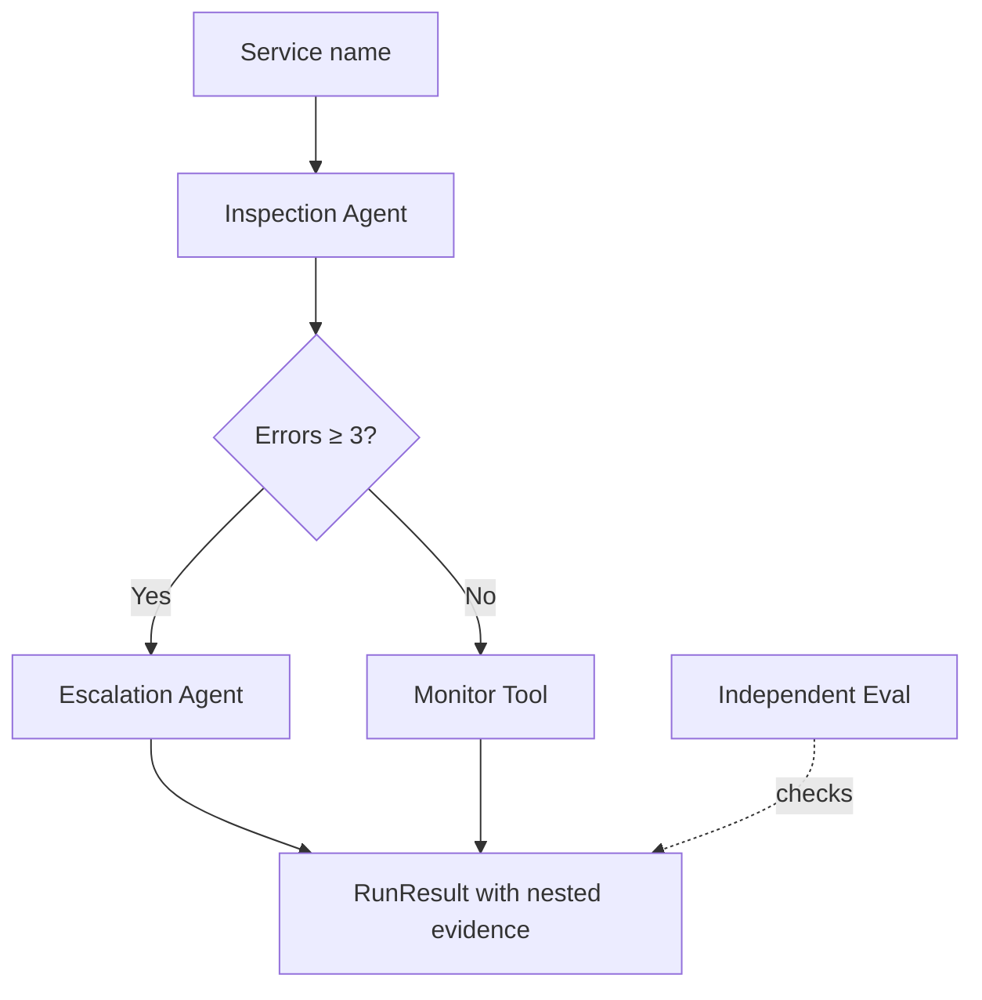
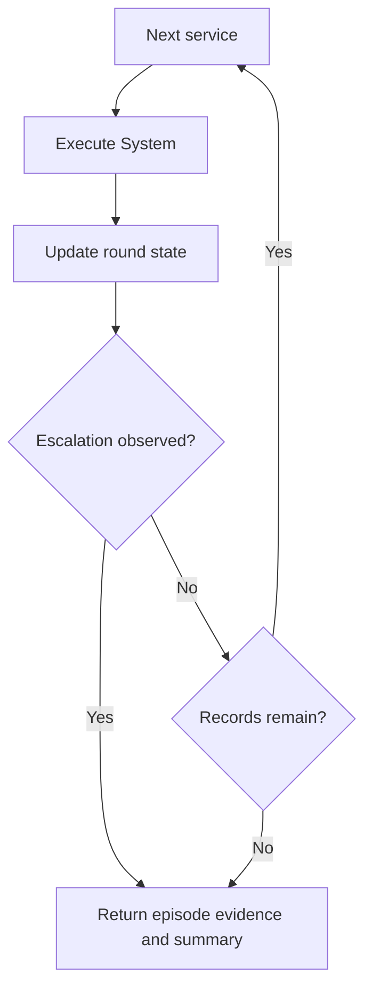
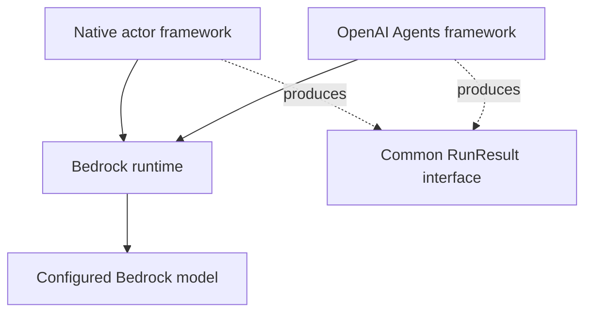

<p align="center">
  
</p>

# Agentic Systems

**Build agentic applications you can compose, inspect, and evaluate.**

Combine tools, model-backed agents, and explicit workflows. Coordinate capabilities through systems, run episodes in environments, and evaluate both the outputs and the actions that produced them.

Agentic Systems connects graph orchestration, actor frameworks, and runtime providers through **execution contracts and a shared evidence model**.

Use it when you need to compose capabilities without losing their execution history, check whether required tools actually ran, or evaluate an application across supported integrations.

[Documentation](https://github.com/JacoboGGLeon/agentic_systems/blob/main/docs/README.md) · [Tutorials](https://github.com/JacoboGGLeon/agentic_systems/blob/main/tutorials/README.md) · [Examples](https://github.com/JacoboGGLeon/agentic_systems/blob/main/examples/README.md)

## Install

Python **3.10–3.14**:

```bash
pip install "agentic-systems==2.1.8"
```

## Start with one capability

This local example reads a service-health snapshot. It needs no model account. Start with a deterministic capability; add model-selected actions when your task needs them.



```python
import agentic_systems as toolkit
from pydantic import BaseModel


class Incident(BaseModel):
    service: str
    errors: int | None = None
    action: str | None = None


context = toolkit.Context(
    {"services": {"catalog": 0, "checkout": 7}},
    sources=("demo-health-snapshot-v1",),
)


@toolkit.tool
def inspect_service(service: str, *, context: toolkit.Context) -> dict:
    return {"errors": context.data["services"][service]}


graph = toolkit.Graph(Incident)
graph.add_node("inspect", inspect_service)
graph.add_edge(toolkit.START, "inspect")
graph.add_edge("inspect", toolkit.END)

inspector = toolkit.Agent("inspector", graph=graph, context=context)
result = inspector.run({"service": "checkout"})

assert result.ok and result.data["errors"] == 7
print(result.data)
```

Output:

```text
{'service': 'checkout', 'errors': 7}
```

The Tool performs the operation. Context supplies information and its source. The Agent owns the capability graph. The same capability can run independently or become part of a larger application.

## Inspect the work, then evaluate it

The result includes more than business data:

```python
evidence = result.evidence()
lineage = result.lineage()
print(result.human_results())
assert result.check_invariants().ok
```

Excerpt from the local execution:

```text
inspector: COMPLETED
Input: {"service":"checkout"}
Output: {"service":"checkout","errors":7}
Process:
- Tool inspect_service: completed -> {"errors":7}
```

Use Eval to check the answer **and** the observed tool call:



```python
def checked_inspection(result, case):
    calls = [
        event
        for execution in result.walk()
        for event in execution.tool_events
        if event.name == "inspect_service"
    ]
    return {"ok": len(calls) == 1 and calls[0].ok
            and calls[0].input == case["input"]}


evaluation = toolkit.Eval(
    "inspection_acceptance",
    unit=inspector,
    cases=({
        "input": {"service": "checkout"},
        "expected": {"ok": True, "data": {"service": "checkout", "errors": 7}},
    },),
    checks=(checked_inspection,),
)
evaluation_result = evaluation.run()
assert evaluation_result.ok

negative_control = toolkit.Eval(
    "reject_wrong_measurement",
    unit=inspector,
    cases=({
        "input": {"service": "checkout"},
        "expected": {"ok": True, "data": {"service": "checkout", "errors": 0}},
    },),
)
negative_result = negative_control.run()
assert not negative_result.ok
print("Expected measurement accepted:", evaluation_result.ok)
print("Wrong measurement accepted:", negative_result.ok)
```

```text
Expected measurement accepted: True
Wrong measurement accepted: False
```

The first Eval accepts the measured value and verifies the inspection input. The negative control rejects a wrong measurement. A plausible answer alone would not establish that the required operation ran.

Eval can evaluate an Agent, System, or Environment independently. It is fail-fast; use separate evaluations when every negative scenario needs an independent report.

[Evaluation patterns](https://github.com/JacoboGGLeon/agentic_systems/blob/main/docs/EVALUATION.md)

## Coordinate capabilities in a System

Now add an escalation capability. The System decides which path to execute based on the observed error count.



Continue the first example:

```python
@toolkit.tool
def escalate(service: str, errors: int) -> dict:
    return {"action": "escalate"}


@toolkit.tool
def monitor(service: str) -> dict:
    return {"action": "monitor"}


escalation_graph = toolkit.Graph(Incident)
escalation_graph.add_node("decide", escalate)
escalation_graph.add_edge(toolkit.START, "decide")
escalation_graph.add_edge("decide", toolkit.END)
escalation_agent = toolkit.Agent("escalation", graph=escalation_graph)


def route(state):
    return "escalate" if state.errors >= 3 else "monitor"


system_graph = toolkit.Graph(Incident)
system_graph.add_node("inspect", inspector)
system_graph.add_node("escalate", escalation_agent)
system_graph.add_node("monitor", monitor)
system_graph.add_edge(toolkit.START, "inspect")
system_graph.add_conditional_edges(
    "inspect", route, {"escalate": "escalate", "monitor": "monitor"}
)
system_graph.add_edge("escalate", toolkit.END)
system_graph.add_edge("monitor", toolkit.END)

system = toolkit.System("incident_response", graph=system_graph)
response = system.run({"service": "checkout"})

assert response.ok
assert response.data == {"service": "checkout", "errors": 7, "action": "escalate"}
```

These tools record decisions; they do not send alerts or change infrastructure. The branch for `catalog` monitors the service and skips escalation.

Graphs can contain functions, Tools, Agents, and Systems. Each nested execution contributes evidence to the parent result. LangGraph supplies conditional transitions, parallel branches, and reducers; the topology remains explicit.

[Graphs and composition](https://github.com/JacoboGGLeon/agentic_systems/blob/main/docs/GRAPHS.md)

## Run episodes in an Environment

A System coordinates work within an execution. An Environment supplies records, accumulated state, and a stopping policy across episodes.



```python
episode_graph = toolkit.Graph(Incident)
episode_graph.add_node("respond", system)
episode_graph.add_edge(toolkit.START, "respond")
episode_graph.add_edge("respond", toolkit.END)


def update(state, record, result):
    return {"processed": state["processed"] + 1,
            "escalations": state["escalations"] + int(result.data["action"] == "escalate")}


def stop(state, result):
    return state["escalations"] >= 1


environment = toolkit.Environment(
    "service_round",
    graph=episode_graph,
    records=({"service": "catalog"}, {"service": "checkout"}, {"service": "catalog"}),
    state={"processed": 0, "escalations": 0},
    update=update,
    stop=stop,
    max_steps=3,
)
episodes = environment.run()

assert episodes.ok and len(episodes.data["outputs"]) == 2
assert episodes.data["summary"]["state"] == {"processed": 2, "escalations": 1}
```

The round stops after the first escalation. Its result retains the episode executions and accumulated summary. Eval can independently check those outputs and stopping behavior.

## Add a model when it needs to choose an action

Suppose users can ask either for a service's current health or for recovery guidance. Give an actor both tools and let it select the appropriate operation.

```bash
pip install "agentic-systems[bedrock,openai-agents]==2.1.8"
```

The following continues the tool and Context declarations above. It requires an AWS region, a supported Bedrock model, and permissions. Running its calls uses real Bedrock inference.

```python
import os
import boto3


@toolkit.tool
def read_runbook(service: str) -> dict:
    return {"guidance": f"For {service}: inspect recent changes and dependency failures."}


runtime = toolkit.runtime(
    provider="bedrock-runtime",
    model=os.environ["BEDROCK_MODEL_ID"],
    session=boto3.Session(region_name=os.environ["AWS_REGION"]),
    max_turns=3,
    max_tool_calls=1,
    max_tokens=256,
    max_retries=0,
)
service_skill = toolkit.skill(
    name="service_support", tools=(inspect_service, read_runbook),
)
instructions = (
    "For current health, call inspect_service. For recovery guidance, call read_runbook. "
    "Use the service named by the user."
)
policy = {"tool_choice": "required"}
contract = {
    "tool_expectation": {"any_of": ["inspect_service", "read_runbook"], "min_count": 1},
    "completion": "when_required_tools_satisfied",
}

assistant = toolkit.Agent(
    "service_support",
    runtime=runtime,
    framework=toolkit.framework("native"),
    context=context,
    skills=(service_skill,),
    instructions=instructions,
    policy=policy,
    contract=contract,
)
model_result = assistant.run("Read recovery guidance for checkout.")
```

An `Agent(graph=...)` follows the explicit workflow you declare. An `Agent(runtime=...)` executes an actor. Both return `RunResult`; actor calls can participate inside graph callbacks with nested evidence.

The contract requires a successful call to one of the declared tools. A task-specific Eval should additionally verify that the actor chose the appropriate one. The full nested-actor example is available in [the executable tutorial](https://github.com/JacoboGGLeon/agentic_systems/blob/main/examples/readme/incident_response.py).

### Switch the framework and keep Bedrock

```python
other_assistant = toolkit.Agent(
    "service_support",
    runtime=runtime,
    framework=toolkit.framework("openai-agents"),
    context=context,
    skills=(service_skill,),
    instructions=instructions,
    policy=policy,
    contract=contract,
)
other_result = other_assistant.run("Read recovery guidance for checkout.")
```

OpenAI Agents is the actor framework; Bedrock remains the model provider. The surrounding composition and result-inspection interfaces remain available. Supported integrations do not imply universal feature parity.



These are alternative configurations; the diagram does not imply simultaneous execution.

| Layer | Supported paths |
|---|---|
| Graph orchestration | LangGraph |
| Actor framework | Native, OpenAI Agents, Strands |
| Runtime provider | Python, OpenAI, Bedrock, Ollama, vLLM |
| Interoperability | MCP and A2A through supported integration paths |
| Serving configuration | `model_artifact(...)`, `model_server(...)` |

[Integration guide](https://github.com/JacoboGGLeon/agentic_systems/blob/main/docs/INTEGRATIONS.md)

## Choose the execution and observation tools you need

Agent, System, Environment, and Eval expose `compile()`, `run()`, `arun()`, and `inspect()`. Compilation prepares execution without business work or model inference. Direct `run()` compiles internally.

```python
program = system.compile()
compiled_result = program.run({"service": "catalog"})
assert compiled_result.ok and compiled_result.data["action"] == "monitor"
```

Agent/System accept execution input; Environment uses declared records and Eval uses declared cases. Tools expose `run()`, `arun()`, and `inspect()` independently.

| Result method | Returns | Purpose |
|---|---|---|
| `evidence()` | `dict` | Export execution evidence and children. |
| `lineage()` | Lineage object | Inspect execution and tool relationships. |
| `trace()` | `dict` | Obtain a bounded execution projection. |
| `human_results()` | `str` | Read an execution summary. |
| `walk()` | Generator of `RunResult` | Visit the result and descendants. |
| `check_invariants()` | Validation object | Check structural consistency, independently of business correctness. |

Context supplies reference information. Optional Memory retains bounded prior execution observations. Reuse a Memory instance for continuity; use a new instance for an independent scenario. Eval isolates toolkit Memory changes per case, starting from the existing history.

[Execution](https://github.com/JacoboGGLeon/agentic_systems/blob/main/docs/EXECUTION.md) · [Results](https://github.com/JacoboGGLeon/agentic_systems/blob/main/docs/RESULTS.md) · [Context and Memory](https://github.com/JacoboGGLeon/agentic_systems/blob/main/docs/CONTEXT_MEMORY.md)

## Build with the authoring skill

The wheel includes version-matched instructions, references, and examples for coding assistants.

```bash
agentic-systems skill info
agentic-systems skill install
agentic-systems skill export agentic-systems-skill-2.1.8.zip
```

Install defaults to `.agents/skills/agentic-systems`. The authoring skill helps write applications; runtime `toolkit.skill(...)` groups application capabilities.

[Download the 2.1.8 skill ZIP](https://github.com/JacoboGGLeon/agentic_systems/releases/download/v2.1.8/agentic-systems-skill-2.1.8.zip)

Additional CLI commands: `agentic-systems version`, `agentic-systems api`, and `agentic-systems doctor`. Doctor checks dependencies, not service access.

## Learn by task

| Goal | Start here |
|---|---|
| Learn the concepts and API | [Concepts](https://github.com/JacoboGGLeon/agentic_systems/blob/main/docs/CONCEPTS.md) and [core tutorials](https://github.com/JacoboGGLeon/agentic_systems/tree/main/tutorials/core) |
| Build graphs and evaluate trajectories | [Graphs](https://github.com/JacoboGGLeon/agentic_systems/blob/main/docs/GRAPHS.md) and [Eval patterns](https://github.com/JacoboGGLeon/agentic_systems/blob/main/docs/EVALUATION.md) |
| Configure OpenAI | [OpenAI tutorial](https://github.com/JacoboGGLeon/agentic_systems/blob/main/tutorials/providers/01_openai.md) |
| Configure Bedrock and AWS sessions | [Bedrock tutorial](https://github.com/JacoboGGLeon/agentic_systems/blob/main/tutorials/providers/03_bedrock.md) and [AWS configuration](https://github.com/JacoboGGLeon/agentic_systems/blob/main/docs/ADA_214.md) |
| Use Ollama or vLLM | [Ollama](https://github.com/JacoboGGLeon/agentic_systems/blob/main/tutorials/providers/02_ollama.md), [local GPU](https://github.com/JacoboGGLeon/agentic_systems/blob/main/tutorials/providers/05_ollama_gpu.md), [vLLM](https://github.com/JacoboGGLeon/agentic_systems/blob/main/tutorials/providers/04_vllm_serving.md) |
| Explore frameworks, MCP, and A2A | [Framework tutorials](https://github.com/JacoboGGLeon/agentic_systems/tree/main/tutorials/frameworks) and [protocol example](https://github.com/JacoboGGLeon/agentic_systems/tree/main/examples/patterns/strands_protocol_graph) |
| Explore semantic acceptance campaigns | [Historical semantic challenges](https://github.com/JacoboGGLeon/agentic_systems/tree/main/semantic_challenges) |

## Verification and execution boundaries

Unit tests, simulated transports, and live campaigns establish different things. Historical campaigns remain tied to their versions and artifact identities. See [2.1.8 validation](https://github.com/JacoboGGLeon/agentic_systems/blob/main/docs/VALIDATION_218.md) and [historical AWS session tests](https://github.com/JacoboGGLeon/agentic_systems/blob/main/docs/AWS_SESSION_VALIDATION_217.md).

Memory and continuations are process-local. Timeouts do not guarantee thread termination or rollback. Boto3 sessions are borrowed resources excluded from configuration JSON; supply a session in each destination process. Per-run limits are not a persistent campaign spending budget. SDK redaction is not general anonymization. Recorded SageMaker tests do not establish EMR or distributed Spark compatibility.

[Known issues](https://github.com/JacoboGGLeon/agentic_systems/blob/main/docs/OPEN_ISSUES_214.md) · [Release notes](https://github.com/JacoboGGLeon/agentic_systems/blob/main/docs/RELEASE_NOTES_218.md)
