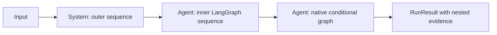

> **Prototipo histórico sustituido.** La API actual vive en el SDK raíz. Consulta [los seis flujos vigentes](../../grammar_tour/README.md). Las rutas y evidencias que siguen pertenecen al experimento anterior.

# Agentic Systems 2.1.3: API revision candidate, offline prototype

This is a runnable experiment, **not a new Agentic Systems release or public
API**. Its Agent/System facades live in `unified_grammar`; the installed
`agentic_systems==2.1.2` package is unchanged. All actors are deterministic
operators. No LLM is mocked as reasoning, and no inference is performed.
The requested version name for this API revision is **2.1.3**; promotion to the
published SDK is pending. The target revision and the tested baseline are
separate manifest fields.

The [design plan](../../docs/GRAMMAR_CLEANUP_PLAN.md) describes the target. This
prototype tests its central execution contract and explicitly limits its scope.

## Run

Use an environment with the dependencies in [requirements.txt](requirements.txt).
No credentials, GPU, Ollama server or AWS session are needed. From the repository
root (or use the corresponding paths in an extracted source bundle):

```text
python examples/unified_grammar/run.py
python examples/unified_grammar/test_offline.py
```

The [six-example notebook](00_walkthrough.ipynb) includes executed outputs in
Spanish: Agent and System, each in sequence, parallel and with direct-function
decisions, on native and LangGraph. It shows input → observed process → output
for every run. Systems coordinate two actual Agents, each with its own Skills.
The walkthrough also explains Skill name resolution, then wraps those same
units in Environment episodes and deterministic Evals. Its additional matrix
covers all 12 units with two records/cases each (24 Environment steps and 24
passing Eval cases), plus two deliberately wrong expectations that Eval must
reject. These are existing wrappers; no new grammar constructors were added.
The notebook also includes the [order challenge](order_challenge/system.py):
seven Agents, seven Skills and eight Tools, a sequential intake pipeline,
parallel pricing/inventory checks and direct-function business decisions.
Seven contracts per backend cover approvals, business rejections, manual review,
invalid input, duplicate SKU lines and a controlled inventory failure that must
preserve the completed quote. Environment and Eval reuse the same declaration.

The [complete scaffolder layout](../../docs/SCAFFOLDER_213.md) documents both the
library and generated application. Generate into a new directory with:

```text
python examples/unified_grammar/scaffold.py /path/to/new-project
```

The project contains source, fixtures, configuration, notebook, tests, manifest,
checksums and the isolated grammar facade. It depends on the unchanged 2.1.2
wheel and has no credentials or live-provider route. Generation is not validation;
the emitted manifest initially says `not-run-generated-project`.

Install Jupyter dependencies (the prototype's optional `notebook` extra, or
`nbformat`, `nbclient`, `ipykernel`) before running:

```text
python examples/unified_grammar/execute_notebook.py
```

This starts a fresh kernel using that same Python executable, clears old outputs,
executes all cells and saves both the walkthrough and its evidence copy. Use the
non-editable 2.1.2 wheel environment; the notebook rejects an editable import.
Windows must permit Jupyter/asyncio's local control transport. The guard inside
the kernel still forbids application connections and subprocesses.

The first command writes [evidence/offline-run.json](evidence/offline-run.json).
The second runs only this prototype's offline tests, disabling unrelated pytest
auto-plugins without relaxing the network/subprocess guard. Run either command
in a dedicated process: its audit hook remains active until that process exits.

For artifact verification, run with a non-editable installation of the published
wheel and pass its local path:

```text
python examples/unified_grammar/run.py report.json --wheel /path/to/agentic_systems-2.1.2-py3-none-any.whl
```

This checks the published SHA-256 and compares every package file against the
installed bytes. Without `--wheel`, the report explicitly says metadata-only
verification. The checked-in evidence was produced with byte verification.

## One owner/flow/lifecycle model

Both experimental Agent and System receive a flow and an explicit backend:

```python
import agentic_systems as toolkit
from unified_grammar import Action, Agent, Sequence, System

@toolkit.tool
def increment(value: int) -> dict:
    """Increment an integer exactly."""
    return {"value": value + 1}

math = toolkit.skill(name="math", tools=[increment])
worker = Agent(
    name="worker",
    skills=(math,),
    flow=Sequence((Action("increment", "increment"),)),
)
application = System(name="application", flow=Sequence((worker,)))

direct = application.run({"value": 3})
prepared = application.compile()  # No action, router, Tool or model executes.
explicit = prepared.run({"value": 3})
assert direct.data == explicit.data == {"value": 4}
```

The same operations work on `worker`. The facade returns the existing 2.1.2
RunResult type. An Agent remains an Agent boundary when nested in a System.
`backend="langgraph"` changes the flow executor, not its nested actors' provider
or Agent framework. Tools and Skills are real 2.1.2 objects; Skills remain
non-executable capability packages. An Action can also adapt a real Python
Runtime Agent while preserving its framework and result evidence.

## Input → process → output

The executable application is defined once in [demo.py](demo.py), shared by
the CLI, [notebook](00_walkthrough.ipynb) and tests.

| Scenario | Input | Process | Output |
|---|---|---|---|
| Sequential Agent or System | `{"value": 3}` | increment, then double | `{"value": 8}` |
| Parallel Agent or System | `{"value": 3}` | increment and double on isolated snapshots; join their values | `{"value": 10}` |
| Graph Agent or System | `{"value": 3}` | increment; route to double for nonnegative values | `{"value": 8}` |
| Graph alternate path | `{"value": -3}` | increment; route directly to END for a negative value | `{"value": -2}` |
| Skill connection in notebook | `{"value": 3}` | Action resolves increment/double by name through its Agent's arithmetic Skill | `{"value": 8}` |
| Environment in notebook | records with values 3 and -3 | same conditional System runs once per record, retaining transitions and episode memory | outputs 8 and -2; memory processed=2 |
| Eval in notebook | inputs 3/-3 with exact expected data 8/-2 | same conditional System runs; deterministic ok/data comparisons | 2/2 cases pass per backend |
| Eval negative control in notebook | input 3, deliberately incorrect expected value 999 | actual output 8 is compared against 999 | Eval fails as expected; candidate execution succeeds |
| Nested System | `{"value": 3}` | LangGraph Agent increments/doubles; native Agent conditionally approves | `{"value": 8, "approved": true}` |
| Environment | two records with values 3 and -3 | new real 2.1.2 episode, shared action limit, two nested-system steps and per-episode memory | outputs 8/approved and -4/rejected; two transitions |
| Eval | two cases with exact expected data | real 2.1.2 Eval plus a deterministic exact-data assertion, no semantic judge | two passing cases; wrong expected data fails in negative controls |



## Flow and state semantics

- `Sequence((...))`: next step receives the previous result's explicit data.
- `Parallel((...), join=...)`: concurrent branches receive independent JSON
  snapshots. The mandatory join sees branch results in declared name order.
  Required branch failure prevents the success reducer from hiding it.
- `Graph(nodes=..., edges=..., start=...)`: explicit state replacement and a
  visit limit. Each edge contains a fixed destination name or a direct Python
  function returning a node name or `"END"`. A Parallel node inside
  a graph expresses fork/join. Arbitrary multi-edge DAGs and implicit reducers
  are not supported by this prototype.
- Direct decision functions are passed in the edge itself, e.g.
  `("increase", choose_next)`. Compilation never executes the function or infers
  its return values. The possible destinations exposed to LangGraph are all
  nodes in that graph plus END; an inspection can therefore show a broader set
  of possible edges than a particular function chooses. At runtime an invalid
  return fails explicitly, retaining prior results and Tool events. The selected
  destination is recorded in the node result's `meta["next"]`.
- Existing `Route(choose, targets)` definitions remain accepted with their
  original restricted-target semantics. The teaching notebook uses only direct
  functions; no new flow constructors or fluent builders were introduced.
- Definitions use frozen dataclasses and tuple structure. There is no compilation
  cache. A prepared object retains its selected topology; a new definition is
  compiled afresh. Referenced callables/Tools and their external state are not
  deep-frozen or proven pure.
- Input bindings, routers and joins must use JSON business values; actions return
  dictionaries or RunResult. Missing Skill Tools, duplicate names, unknown route
  targets, unsupported backends and invalid snapshots fail explicitly.
- LangGraph builds real StateGraph nodes/edges for sequences, conditional graphs
  and parallel barriers. No fallback to native occurs if the SDK is unavailable.
  Inspect with `owner.compile().inspect()`; advanced SDK objects are available
  on the prepared tree for this experiment, not a promised public interface.

## Environments and Evals

Experimental Environment and Eval also offer run/compile. Compilation prepares
the actor without stepping an episode or evaluating a case. Each Environment run
creates a fresh real 2.1.2 session, preserving its Gym-shaped transition history;
legacy reset/step behavior is untouched. A truncated incomplete episode is
reported as nonpassing by this facade.

Eval uses the existing evaluator and returns its EvalReport inside RunResult.data.
It supports only explicit `expected.ok` and exact typed `expected.data` contracts;
unknown keys are rejected at compile time. The prototype supplies the exact-data
assertion rather than assuming the native evaluator interprets an arbitrary
expected field. It does not implement an LLM judge or certify semantic quality.

The notebook adds no separate backend setting to these wrappers: Environment
and Eval receive the existing Agent/System as `unit`. Environment supplies each
record independently; its episode memory is not automatically injected into an
Agent's input. Eval checks the same unit directly rather than evaluating the
Environment wrapper. Tables retain the input, observed actor steps, selected
route, actual output and comparison outcome. Both wrappers are synchronous.

## Validation and limits

See [the measured report](evidence/REPORT.md),
[raw run evidence](evidence/offline-run.json) and [tests](tests/test_prototype.py).
The matrix covers Agent/System × sequence/parallel/graph × native/LangGraph,
with direct run and compile-then-run, plus nested flows, episode isolation,
negative Evals, failure retention, late Tool completion, shared limits and async
Agent/System execution. Four additional decision cases cover the alternate
branch. [Notebook evidence](evidence/six-examples.json) preserves observed steps,
chosen routes, nested results and the 12 principal / 4 alternative outcomes.
This is deterministic prototype acceptance, not model
or release certification. Only the recorded Python/SDK versions were tested.

Limits are cooperative: action reservations and a monotonic deadline are shared
by declared nested flows/branches and episode/Eval steps. Parallel execution
waits for already-started workers and preserves late results. It cannot kill an
arbitrary stuck Python callback. There are no automatic retries, production
cancellation guarantees, persistent checkpoints, streaming, interrupts, new
provider routes, ADA integration or general semantic-proof guarantees. Async
convenience is implemented for Agent/System; Environment/Eval runners are sync.

The audit hook blocks application socket connections (including loopback/DNS)
and subprocesses. The only connection exception is the standard-library
socketpair connecting its own ephemeral listener, needed by Windows asyncio.
Negative tests still reject an ordinary loopback connection and a subprocess.
This process-local guard is not an OS security boundary for untrusted/native code.

The initial async test's overly broad socket guard failed on Windows; its report
is preserved in [tests-initial-guard.xml](evidence/tests-initial-guard.xml).
The final suite is [tests.xml](evidence/tests.xml). Earlier development also
exposed the missing exact-data assertion and unsafe deep-copying of SDK-private
cyclic objects; dedicated regressions now cover those boundaries. Do not treat
an earlier positive-only demo as proof of those negative controls.

Legacy `agent.pipeline`, System run/compile, graph state returns, native invoke
access and the 89 package exports remain unchanged and are characterized by
tests. This syntax stays isolated under `unified_grammar` until an API/version
decision is made. Nothing was published or merged by this experiment.
