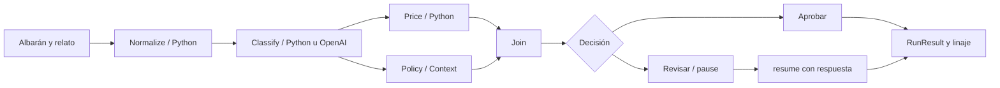

# Reporte de ejecución · Agentic Systems 2.1.4.dev1

La candidata local pasó 278 regresiones offline y seis combinaciones de OpenAI real. No está publicada. La aceptación se limita a los casos y entornos que se describen aquí.

## Qué aporta la librería

Una misma declaración conecta operaciones Python, actores de distintos SDK y un motor de orquestación, con contexto, memoria y un contrato RunResult común. Agent organiza el trabajo de una unidad; System compone unidades; Environment conduce esas unidades a través de observaciones y estado. Las tres responsabilidades conservan su identidad y evidencia aunque compartan el motor de grafo.

Sequence, Parallel y Graph son formas de declarar el mismo plan interno de nodos, aristas, decisiones y barreras. Native interpreta ese plan; LangGraph lo compila como StateGraph, incluidos subgrafos. LangGraph ya no se presenta como framework de agente. Los actores disponibles en este prototipo son native, OpenAI Agents y Strands.

El beneficio frente a escribir toda la aplicación directamente en un SDK es reutilizar contratos, límites, contexto, memoria y evidencia al cambiar la implementación del actor o al combinarla con Python. Una aplicación pequeña basada en un único SDK puede necesitar menos capas usando ese SDK directamente. Esta capa no reproduce ni certifica automáticamente todas sus capacidades.

## Input → proceso → output

**Input:** pedido R-17 de 240 MXN, albarán con adaptador y sensor, lista recibida con solo el adaptador y relato del cliente solicitando devolver todo.

**Proceso:** normalizar → clasificar evidencia → calcular dinero y aplicar política en paralelo → elegir aprobación o revisión. El importe a reembolsar se calcula en Python: 240 × 1 / 2 = 120. El relato no autoriza por sí mismo un reembolso total.

**Output:** RunResult con order_id=R-17, refund=120, currency=MXN, missing_units=1, fuentes y explicación. Native concluye con pending_review; las rutas LangGraph se pausan, reciben True y concluyen con approved. Esa diferencia corresponde a la interacción solicitada, no a un cambio en el cálculo.

**Operador:** compara listas estructuradas mediante una Tool. No interpreta lenguaje natural. **Razonador:** usa el OpenAI real configurado, gpt-4.1-mini, para interpretar relato y fuentes y devolver el mismo contrato JSON. La aritmética y las reglas finales siguen en Tools Python. Razonador es aquí el rol de la aplicación; no una afirmación de que el modelo exponga un proceso interno de razonamiento.

Context delimita política, moneda y fuentes. Skills agrupan capacidades e instrucciones. Memory conserva episodios acotados por proceso. Environment mantiene state entre observaciones; no es la misma memoria episódica. Eval comprueba el resultado con un oráculo determinista y evidencia. El linaje para humanos y agentes resume hechos registrados, no cadenas internas de pensamiento del modelo.

## Matriz ejecutada

| Actor | Orquestación | Python | OpenAI real | Reanudar sin nuevas solicitudes |
|---|---|---|---|---|
| native | native | PASS | PASS | No aplica |
| openai-agents | native | PASS | PASS | No aplica |
| strands | native | PASS | PASS | No aplica |
| native | langgraph | PASS | PASS | 0 adicionales |
| openai-agents | langgraph | PASS | PASS | 0 adicionales |
| strands | langgraph | PASS | PASS | 0 adicionales |

Python ejecutó también Environment con dos casos (state.total=240) y Eval sobre cada combinación. En live se evaluó el resultado capturado, sin volver a invocar el candidato ni usar un juez LM. Todos los resultados son serializables y pasan check_invariants.

## Pausa y reanudación

El programa compilado devuelve status=paused, interrupts y una continuation. resume/aresume consumen esa continuación en el mismo objeto compilado. Los nodos completos no se repiten y la espera humana se excluye del deadline activo. El consumo anterior aparece también en el resultado pausado; un fallo obligatorio impide continuar aunque otra rama haya solicitado aprobación.

Los checkpoints contienen JSON. Los clientes, locks e iteradores quedan fuera. Las continuaciones son locales al proceso: no hay recuperación tras reinicio. Una función interrumpida vuelve a empezar; cualquier efecto previo a pause debe ir en otra Action o ser idempotente. Native rechaza pausas; las pausas deben situarse fuera del bucle interno de SDK y fuera de Eval.

## Hallazgos y correcciones

El primer piloto falló y se conserva íntegro en live-results.json y iterations/dev1-pilot1/. No se ejecutó aceptación sobre ese wheel. La ruta native presentaba el JSON en un envoltorio final_output y el contrato estaba validando el envoltorio. Se corrigió la normalización en la frontera del proveedor, con regresiones offline para los cuatro proveedores externos, incluyendo JSON inválido y un campo de negocio legítimo llamado final_output. No se extraen fragmentos ni se repara silenciosamente una respuesta inválida.

El modelo confundió amount con el reembolso. Se precisó en el prompt que amount conserva el importe original y que el cálculo corresponde a Python. El caso, el oráculo, el modelo, el endpoint y el framework del piloto no se sustituyeron. Se congeló una nueva candidata y se repitieron piloto y aceptación. El hash original de la aplicación del piloto se conserva; su reconstrucción legible archivada no reproduce exactamente esos bytes, como indica SOURCE-NOTE.md. El wheel y los RunResults originales sí se conservan.

## Presupuesto

- Autorización: USD 1 y 20 solicitudes; se detiene ante cualquiera de los topes.
- Solicitudes de transporte: **8 / 20** = 1 piloto fallido + 1 piloto corregido + 6 aceptaciones.
- Reserva conservadora consumida: **USD 0.031772**; saldo USD 0.968228 y 12 solicitudes.
- Tokens registrados, incluidos los del fallo: 3036 input y 715 output. Estimación sin descuentos de caché: USD 0.0023584; no es una factura.
- El contador reserva antes de cada envío y queda instalado hasta terminar el proceso. Fallos, reintentos, evaluadores y trabajadores tardíos no obtienen una vía de salida sin contador. En esta ejecución no hubo solicitudes durante resume.
- La fuente de verdad para solicitudes facturables es el contador de transporte; el campo requests de un RunResult también puede incluir operaciones del runtime Python. No se suman repetidamente copias de evidencia de Eval.
- Tarifas verificadas: [OpenAI GPT-4.1 mini](https://developers.openai.com/api/docs/models/gpt-4.1-mini).

## Evidencia y reproducibilidad

- Wheel no editable: `agentic_systems-2.1.4.dev1-py3-none-any.whl`.
- SHA-256: `133942ade818dd09821db8fe5e20fe260f2fb8f63cb73ec8b1593cea619ac248`.
- Instalación aislada: .tmp/candidate214-dev1/site-packages; se compararon todos los archivos del paquete con los bytes del wheel.
- Python 3.14.2; las versiones exactas de SDK y los hashes de fuentes figuran en validation.json.
- 278 pruebas, 0 fallos, 0 errores, 0 skips. Guard offline: 0 intentos bloqueados y 0 solicitudes reales.
- Ruff y git diff --check satisfactorios. No se ejecutó CI remota ni se publicó.
- Los notebooks se ejecutaron secuencialmente en un proceso Python aislado con guard offline, no mediante un kernel Jupyter. El notebook Context/Memory tiene 6 celdas de código y el de grafo común tiene 9.

| Artefacto | Contenido |
|---|---|
| [validation.json](validation.json) | Aceptación offline, dependencias y hashes |
| [example-results.json](example-results.json) | RunResults, memoria y linaje offline |
| [live-results.json](live-results.json) | Todos los intentos, respuestas reales, Eval y linaje |
| [live-budget.json](live-budget.json) | Registro persistente de reservas antes del envío |
| [Cobertura de gramática](../../docs/GRAMMAR_COVERAGE_214.md) | Palabras ejercitadas por cada ejemplo |
| [Notebook grafo común](../../examples/common_graph/01_common_graph.ipynb) | Seis patrones y caso integrado ejecutados |
| [Notebook Context/Memory](../../examples/context_memory_lineage/01_context_memory_lineage.ipynb) | Contexto, episodios y vistas de linaje |

## Gramática ejercitada

**17 / 20 palabras públicas raíz (85%).** Se cuentan constructores y funciones invocados desde ejemplos, excluyendo __version__, parámetros y métodos. El notebook de grafo común usa 16/20; la aplicación integrada usa 17/20. No es cobertura del 85% de ramas ni de toda la API de los SDK.

No usadas en estos ejemplos: load_skill, model_artifact y model_server. Las dos últimas pertenecen al ciclo de modelos servidos, fuera de esta campaña.

## Alcance pendiente

No se valida aquí Ollama, Bedrock, vLLM, IAM/ADA, MCP/A2A remoto, handoffs avanzados, Studio, memoria persistente, reset/step interactivo, Python 3.10–3.13 ni todo el catálogo histórico. El despacho histórico de varias Tools de python-runtime, protocolos públicos de ejecutables y un frontend de expresiones/pseudocódigo siguen pendientes. No hay un constructor Harness ni compilación de lenguaje natural libre.

Esta evidencia acredita el caso probado y los contratos de regresión sobre este wheel; no constituye una certificación general de razonamiento o de todas las funciones de los frameworks.
